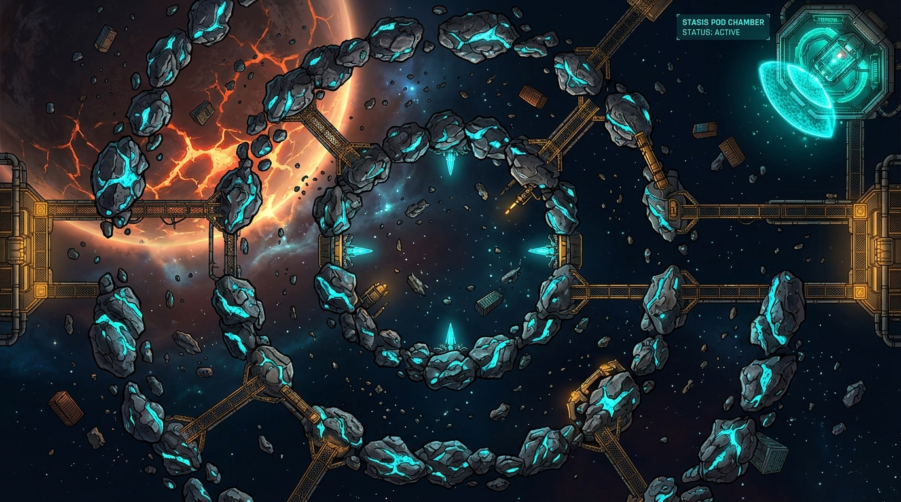
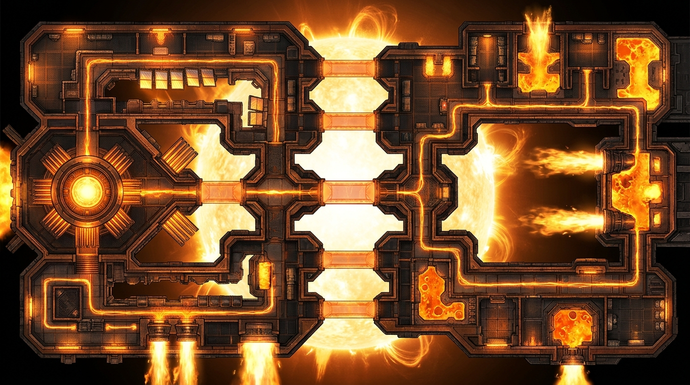
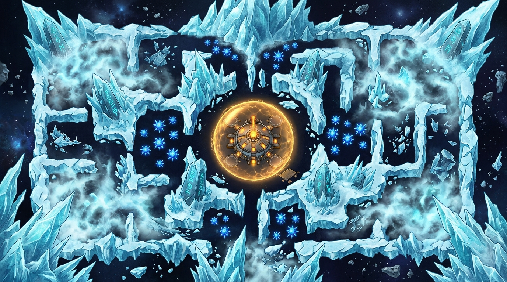
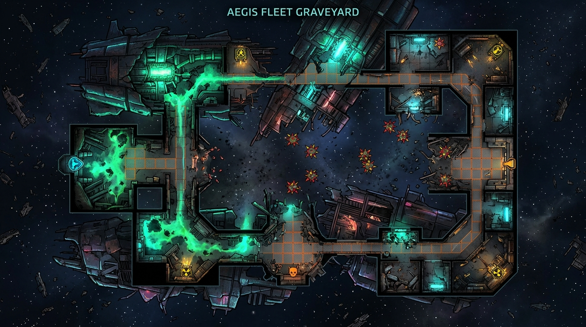
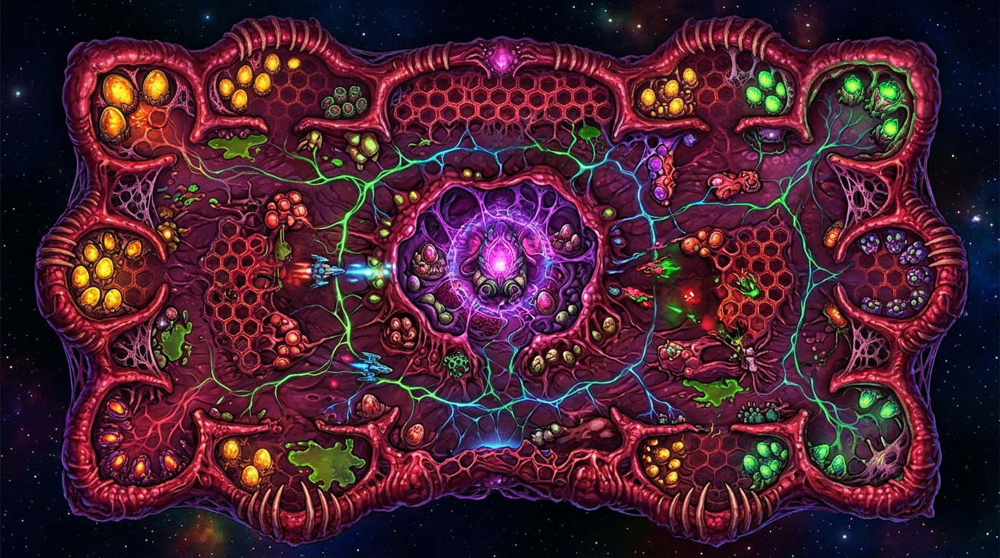
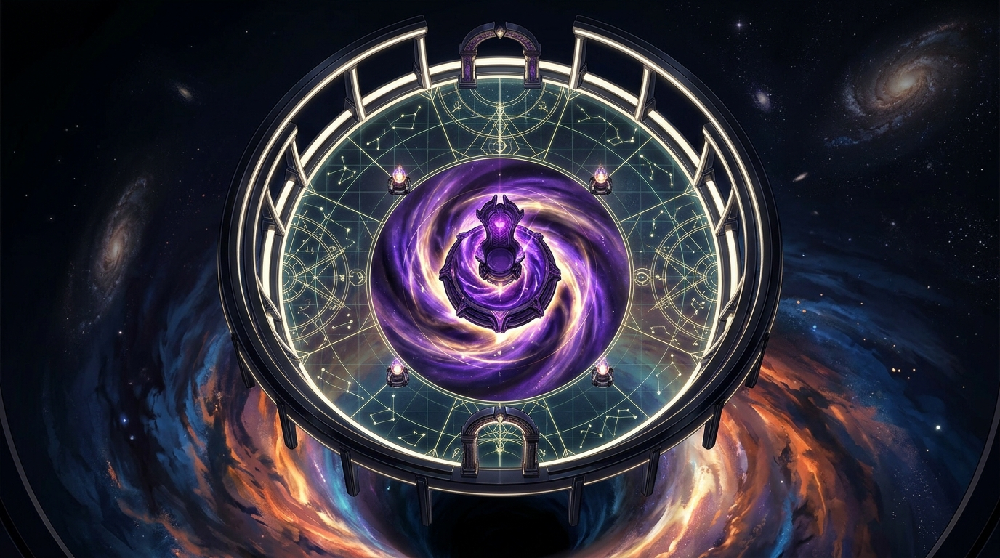

# 🎨 Bíblia Visual & Arquitetura Procedural dos Mapas (Fase 4)

As **6 Imagens Modelo (Concept Art Top-Down 2D)** estão salvas localmente em:
- `docs/biomes/` (para visualização na documentação)
- `assets/images/biomes/` (prontas para uso no Flutter/Flame)

---

## 🖼️ Galeria Rápida das 6 Imagens Modelo

| Bioma | Arquivo de Imagem | Identidade Visual & Macro-Estrutura |
| :--- | :--- | :--- |
| **1. Cinturão de Mineração de Vesta** | [`biomes/biome_1_vesta_belt.jpg`](biomes/biome_1_vesta_belt.jpg) | 2 Anéis concêntricos de asteroides cristalinos ciano ligados por passarelas amarelas, planeta rachado ao fundo e Câmara da Cápsula de Estase no canto superior direito. |
| **2A. Forja Solar de Hélio** | [`biomes/biome_2a_helios_forge.jpg`](biomes/biome_2a_helios_forge.jpg) | Duas grandes asas industriais (Oeste/Leste) conectadas por 5 pontes de energia solar sobre uma Estrela de Dyson ofuscante, com dutos de lava e jatos de fogo. |
| **2B. Abismo Criogênico de Caelum** | [`biomes/biome_2b_cryo_abyss.jpg`](biomes/biome_2b_cryo_abyss.jpg) | Labirinto de paredes de gelo cristalino ciano ao redor de um Domo Térmico Dourado central, com neblina criogênica, minas de gelo e 4 Obeliscos Rúnicos. |
| **3A. Cemitério da Frota Aegis** | [`biomes/biome_3a_aegis_graveyard.jpg`](biomes/biome_3a_aegis_graveyard.jpg) | 3 Cascos colossais de Encouraçados abatidos formando salas e corredores internos, com vazamento de reator verde esmeralda, minas magnéticas e torretas *Derelict*. |
| **3B. Colmeia Xeno-Biológica de Nêmesis** | [`biomes/biome_3b_xeno_hive.jpg`](biomes/biome_3b_xeno_hive.jpg) | Superorganismo vivo com 6 alcobas periféricas de incubação (ovos dourados e verdes), piso de favos hexagonais, veias neurais bioluminescentes e o Coração Real violeta no centro. |
| **4 & 5. Horizonte de Eventos & O Trono do Vazio** | [`biomes/biome_4_5_void_throne.jpg`](biomes/biome_4_5_void_throne.jpg) | Catedral Astrolábio circular de obsidiana e ouro branco suspensa sobre o vórtice espiral de um buraco negro roxo/dourado, com 4 piras astrais e o Trono no centro. |

---

## 🧩 1. Como Resolver a "Questão Procedural" sem Perder Identidade Visual?

Jogos como **Dead Cells**, **Hades** e **Enter the Gungeon** não usam `random()` puro espalhando paredes soltas no vazio (porque isso deixa todos os mapas com cara de bagunça genérica). Eles usam **Geração Procedural por Esqueleto + Módulos (Biome Skeleton + Room Sockets)**:

1. **Macro-Esqueleto Fixo do Bioma:** Define o formato único e reconhecível do mapa (Anéis Concêntricos em Vesta, Refinaria Horizontal com Pontes em Hélio, Labirinto Glacial com Domo Central em Caelum, Cascos de Naves no Cemitério Aegis, Colmeia Celular em Nêmesis, ou Templo Circular no Trono do Vazio).
2. **Slots Modulares (8 a 12 *Sockets* por Mapa):** Pontos predefinidos nas passagens, câmaras laterais e cantos extremos (NW, NE, SW, SE, Norte, Sul).
3. **Sorteio Procedural por Seed:**
   - Alterna quais passagens/pontes estão abertas e quais estão fechadas por portões laser ou paredes destrutíveis;
   - Sorteia em qual dos cantos/alcobas extremas ficará a **Relíquia Permanente**, a **Cápsula de Estase / Evento Secreto**, o **Mercador**, o **Santuário Amaldiçoado** e o **Altar do Chefe**;
   - Varia a distribuição de perigos dinâmicos (Minas, Casulos, Jatos Solares, Vazamentos Radioativos).

### As 4 Camadas de Renderização de Cada Mapa no Flame:
- **Camada 0 — Backdrop Abissal (*Parallax*):** Planeta rachado em Vesta, Estrela de Dyson em Hélio, Nebulosa Glacial em Caelum, Buraco Negro Dourado/Violeta no Trono do Vazio.
- **Camada 1 — Sub-Piso Arquitetural (Sem colisão — Dá escala e leitura tática):** Passarelas metálicas amarelas ligando asteroides (Bioma 1), dutos de lava sob o piso e pontes translúcidas (Bioma 2A), piso de favos orgânicos e veias bioluminescentes (Bioma 3B), linhas de astrolábio dourado (Bioma 4/5).
- **Camada 2 — Paredes e Obstáculos Físicos (Com colisão real para Player, Inimigos, Tiros e Asteroides):**
  - *Rocha Cristalina & Vigas de Mineração* (Bioma 1)
  - *Muralhas de Bronze/Aço com Dutos de Magma* (Bioma 2A)
  - *Paredes de Gelo Translúcido & Cristais Glaciais* (Bioma 2B)
  - *Cascos Rasgados de Encouraçados* (Bioma 3A)
  - *Muralhas de Biomassa Carnosa Pulsante que regeneram* (Bioma 3B)
  - *Arcos Monolíticos de Obsidiana e Ouro Branco* (Bioma 4/5)
- **Camada 3 — Elementos Vivos, Segredos & Eventos:**
  - Extratores Laser, Jatos de Chamas Solares, Domo Térmico Central, Vazamentos de Reator Verde, Bolsas de Ovos Xeno e Piras Astrais.

---

## 🗺️ 2. Decomposição Detalhada de Cada Mapa

### 🪨 Mapa 1: Cinturão de Mineração de Vesta (`VestaBeltMapBuilder`)

- **Visual & Fundo:** Planeta vulcânico rachado no canto superior esquerdo; espaço azul-petróleo profundo.
- **Macro-Esqueleto:** **2 Anéis Concêntricos de Asteroides Cristalinos Fixos** (Anel Interno a `650px` do centro e Anel Externo a `1350px` do centro), interligados por **Passarelas de Mineração Douradas** (Camada 1) e **Docas Laterais** a Leste e Oeste.
- **Variação Procedural (por Seed):**
  - Quais brechas nos 2 anéis de rocha estão abertas e quais estão seladas por **Extratores de Laser Ciano**;
  - Posição da **Câmara da Cápsula de Estase (Stasis Pod Chamber)** com escudo hemisférico ciano em um dos 4 cantos extremos (NE, NW, SE, SW);
  - Posição do **Pedestal da Relíquia (Radar Estelar Aegis)** no canto oposto;
  - Distribuição dos contêineres de carga (`CargoWreckComponent`) flutuando entre os dois anéis.

---

### 🔥 Mapa 2A: Forja Solar de Hélio (`HeliosForgeMapBuilder`)

- **Visual & Fundo:** Uma colossal **Estrela de Dyson** brilhando exatamente no centro ao fundo, iluminando o espaço entre as duas asas da megaestrutura.
- **Macro-Esqueleto:** **Duas Grandes Asas Industriais (Oeste e Leste)** ligadas no meio por **5 Pontes de Energia Solar Translúcidas** que cruzam por cima da estrela!
  - Na **Asa Oeste** fica a **Câmara Octogonal da Fornalha Principal** (onde desperta o Chefe *Ignis Wyrm* ou o *Reator Solar*).
  - Na **Asa Leste** ficam as **Câmaras de Fundição e Jatos de Plasma** (propulsores gigantes que cospem línguas de fogo periodicamente).
  - Dentro das paredes metálicas correm **Canais de Lava Incandescente** brilhantes.
- **Variação Procedural (por Seed):**
  - Quais das 5 pontes centrais estão ativas ou bloqueadas por barreiras térmicas;
  - Tempo de ciclo dos **Jatos de Propulsão Solar** nas câmaras;
  - Localização do **Tomo de Fusão Térmica (Relíquia)** nos cofres laterais da refinaria.

---

### ❄️ Mapa 2B: Abismo Criogênico de Caelum (`CryoAbyssMapBuilder`)

- **Visual & Fundo:** Uma caverna/bacia espacial cercada por **Paredes de Gelo Cristalino Pontiagudo** nas bordas e corredores glaciais internos.
- **Macro-Esqueleto:**
  - **No Centro Exato:** O **Domo Térmico Dourado (`ThermalDomeComponent`)** — uma estação aquecida com escudo âmbar onde o frio não entra e o Mercador Errante se abriga!
  - **Ao Redor do Domo:** Corredores de gelo formando um labirinto simétrico com **4 Obeliscos Rúnicos de Caelum** cravados no gelo nos 4 quadrantes.
  - **Perigos:** Nuvens densas de neblina branca-azulada (`CryoMistZoneComponent`) nas alas laterais e enxames de minas azuis em formato de estrela de gelo (`CryoMineComponent`).
- **Variação Procedural (por Seed):**
  - Quais corredores de gelo estão abertos ou bloqueados por geleiras destrutíveis;
  - Quais dos 4 Obeliscos Rúnicos guardam a **Relíquia do Mercador** e a arma **Quantum Chakram**.

---

### ⚓ Mapa 3A: Cemitério da Frota Aegis (`AegisGraveyardMapBuilder`)

- **Visual & Fundo:** O interior e o entorno de **3 Cascos Colossais de Encouraçados Abatidos** flutuando no vácuo, interligados por passarelas de grade laranja.
- **Macro-Esqueleto:**
  - **Ala Esquerda (Casco Corrompido):** Um rio de **Radiação Esmeralda do Reator** (`ReactorLeakHazardComponent`) vaza pelos corredores internos do encouraçado, levando até uma câmara blindada a Oeste.
  - **Pátio Central (Zona de Impacto):** Espaço aberto entre os cascos rasgados, coalhado de **Minas Magnéticas Vermelhas de Espinhos** e destroços.
  - **Ala Direita (Casco de Comando):** Salas táticas quadradas com **Torretas Automáticas Derelict** e cofres de munição marcados com símbolo radioativo amarelo.
- **Variação Procedural (por Seed):**
  - Portas de anteparo abertas/fechadas entre os compartimentos do encouraçado;
  - Posição das Caixas Pretas (`FlightRecorderLog`) e da **Relíquia Matriz de Mutações** nas salas de comando.

---

### 🧬 Mapa 3B: Colmeia Xeno-Biológica de Nêmesis (`XenoHiveMapBuilder`)

- **Visual & Fundo:** Um superorganismo vivo flutuando no espaço: paredes de carne e quitina carmesim com costelas espinhosas, piso de membrana em favos hexagonais e **Veias Neurais Bioluminescentes** (verdes e ciano) que pulsam até o centro.
- **Macro-Esqueleto:**
  - **Centro da Colmeia:** A **Câmara do Coração Real (`RoyalHiveHeartComponent`)** — um santuário orgânico violeta cercado por tentáculos onde o *Carrier Hive Alpha* desperta.
  - **6 Alcobas de Incubação nas Bordas (Noroeste, Sudoeste, Norte, Sul, Nordeste, Sudeste):** Bolsões orgânicos recheados de **Ovos Dourados e Verdes (`XenoCocoonComponent`)** e **Poças de Ácido Bio-Corrosivo** (`AcidPoolHazardComponent`).
- **Variação Procedural (por Seed):**
  - Qual das 6 alcobas periféricas guarda o **Selo Amarelo de Nêmesis (Relíquia)** e qual guarda o **Casulo Real da Astraea**;
  - Paredes de biomassa (`OrganicBiomassWallComponent`) que bloqueiam atalhos e precisam ser abertas a tiro (regenerando depois de alguns segundos!).

---

### 🕳️ Mapa 4 & 5: Horizonte de Eventos & O Trono do Vazio (`VoidThroneMapBuilder`)

- **Visual & Fundo:** Uma **Catedral Astrolábio Circular** dos Arquitetos Ancestrais suspensa diretamente sobre o vórtice espiral roxo e dourado de um buraco negro gigantesco.
- **Macro-Esqueleto:**
  - **Anel Externo de Colunatas:** Muralhas curvas em arco de obsidiana e ouro branco com **Portais Astrais** ao Norte e ao Sul.
  - **Piso de Constelações Sagradas:** Grade geométrica dourada com **4 Piras/Pilares dos Arquitetos** nos pontos diagonais (que precisam ser sintonizados para baixar o escudo do Trono).
  - **Centro Absoluto:** O **Trono do Vazio** sobre o olho da singularidade.
