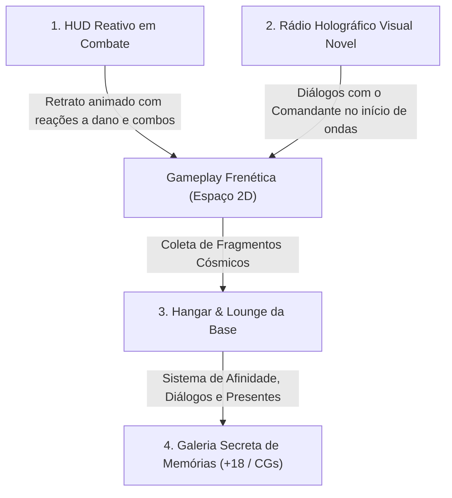

# 🎨 Pipeline de Arte, Personagens e Idioma (MVP)

**Projeto:** *Astra Valkyries: Void Protocol*  
**Repositório:** `momarinho/astra-valkyries` (Comercial / Privado)  
**Versão:** 1.0  
**Data:** 05/11/2026  

---

## 🌐 1. Diretriz de Idioma Primário (Steam & Global Market)

> [!IMPORTANT]
> **O jogo será desenvolvido e lançado PRIMARIAMENTE EM INGLÊS (EN).**

- **Justificativa Comercial:** O maior volume de vendas e listas de desejos (*wishlists*) na Steam para jogos do gênero *Bullet Heaven / Anime Action Roguelite* provém dos Estados Unidos, Europa e Ásia (jogadores internacionais consom rotineiramente jogos em inglês).
- **Escopo Inicial (Launch 1.0):**
  - Toda a Interface do Usuário (UI), nomes de armas, sinergias, cartas, tutoriais e diálogos de rádio estarão exclusivamente em **Inglês**.
  - A voz das personagens (*Voice Grunts / Battle Callouts*) seguirá o padrão clássico em **Japonês (JA)** ou **Inglês (EN)** para manter a autenticidade do estilo anime.
- **Localizações Futuras (Pós-lançamento / Updates):**
  - Português Brasileiro (PT-BR).
  - Japonês (JA).
  - Chinês Simplificado (ZH-CN).

---

## 🎯 2. Posicionamento de Mercado: Waifus & Arquétipos

- **Demografia Principal:** Jogadores de roguelites frenéticos e entusiastas da cultura otaku/anime na Steam (*Azur Lane, Nikke, Vampire Survivors, Nova Drift*).
- **Decisão sobre Femboys:**
  - O elenco principal de lançamento foca **100% em Waifus** para garantir clareza nas tags da Steam (`Anime`, `Bullet Hell`, `Female Protagonist`, `Action Roguelike`, `Sexual Content / Nudity Mild`).
  - O nicho de apelo andrógino é capturado pelo arquétipo da **Tomboy / Cavaleira Rebelde** (cabelo curto, postura confiante, atitude ousada).
  - Personagens *femboy* ou arquétipos experimentais ficam reservados para **desbloqueios secretos de endgame ou DLCs temáticas futuras**, evitando atrito nas avaliações da loja base.

---

## 🖼️ 3. As 4 Camadas de Aparição das Personagens no Jogo



### 3.1. Mini-Avatar Reativo na HUD (Durante a Partida)
- Localizado no canto superior/inferior da tela ao lado das barras de escudo e casco.
- Expressões dinâmicas que reagem ao estado de combate:
  1. **Neutra / Foco:** Pilotagem normal.
  2. **Dano Crítico / Battle Damage:** Roupas levemente rasgadas/desajustadas, expressão de esforço/dor leve com rubor facial e áudio de alerta.
  3. **Ataque Supremo / Especial:** Olhar triunfante com animação de corte de tela estilo anime (*Cut-in*).

### 3.2. Transmissão de Rádio Holográfica (Visual Novel Box)
- Caixas de diálogo semi-translúcidas futuristas que surgem na tela antes do spawn de chefes ou ao ingressar em um novo setor.
- Sprite em meia-altura (*half-body*) das pilotos se comunicando diretamente com o jogador ("O Comandante").

### 3.3. Hangar & Lounge das Valkyries (Meta-Game)
- Tela principal fora das partidas onde o jogador interage com o sprite de corpo inteiro (*full-body*) da piloto selecionada.
- **Sistema de Afinidade (Bond System):** Presentes encontrados nas fases aumentam o nível de carinho, liberando novas linhas de voz, curiosidades da história e missões pessoais.

### 3.4. Galeria Secreta de Memórias (+18 / Event CGs)
- **Principal motor de retenção e vendas do jogo:**
  - Ilustrações completas de tela cheia (1920x1080) desbloqueadas ao cumprir recordes ou elevar o nível de afinidade.
  - Cenas de descanso no deck de gravidade zero, descontaminação/banho após missões e trajes alternativos provocantes.
  - **Política Steam:** O jogo base permanece em classificação *Ecchi Moderado / Teens-to-Mature* (sem banimentos regionais), com opção de patch sem censura gratuito no Itch.io.

---

## 👥 4. O Trio Inicial do MVP (As 3 Primeiras Valkyries)

| Personagem | Título | Visual / Cabelo | Personalidade / Tropo | Nave & Arma Inicial |
| :--- | :--- | :--- | :--- | :--- |
| **Lyra** | *Solar Vanguard* | Ruiva/coral, mechas dinâmicas, olhos âmbar, headset mecha-neko branco e exo-traje cibernético | Enérgica, ousada, confiante, adora velocidade | Interceptador veloz *AV-01 Sol Blaze* com *Twin Vulcan Plasma* |
| **Selene** | *Void Tactician* | Prateado/Azul gelo longo, visor holográfico | Kuudere fria, analítica, fala com calma calculada | Fragata tática azul com *Phase Laser Piercing Beam* |
| **Vesper** | *Dread Renegade* | Cabelo escuro curto com mechas magenta (Tomboy) | Rebelde, provocante, debochada, adora explosões | Caça furtivo preto com *Antimatter Spread & Bombs* |

---

## 📋 5. Checklist de Assets Necessários para o MVP

Para cada uma das 3 personagens, os seguintes arquivos deverão ser gerados e organizados na pasta `assets/art/valkyries/`:

### Por Personagem (Exemplo: `lyra/`):
- [ ] `hud_neutral.png` (512x512, PNG transparente, busto)
- [ ] `hud_damaged.png` (512x512, PNG transparente, busto com battle damage e rubor)
- [ ] `hud_ultimate.png` (512x512, PNG transparente, busto em ângulo triunfante)
- [ ] `hangar_fullbody.png` (1024x1536, PNG transparente, corpo inteiro com traje de piloto)
- [ ] `gallery_cg_01.png` (1920x1080, 16:9 Widescreen, ilustração de evento especial)
- [ ] `ship_topdown.png` (256x256, PNG transparente, nave vista estritamente de cima nas cores da piloto)

---

## 🛠️ 6. Guia Prático de Geração por Inteligência Artificial

### 6.1. Ferramentas Recomendadas
1. **SeaArt.ai / Leonardo.ai (Web - Rápido):**
   - Modelos recomendados: *Anime XL*, *Counterfeit XL* ou *Pony Diffusion*.
   - Excelente aderência a trajes futuristas e expressões faciais.
2. **Midjourney (Modo `--niji 6`):**
   - Melhor acabamento de iluminação e consistência artística de anime moderna.
3. **Stable Diffusion Local (ComfyUI / WebUI Forge):**
   - Modelos: *Pony Diffusion V6 XL* ou *Illustrious-XL*. Permite usar LoRAs específicas para fixar o rosto da personagem entre diferentes poses.

### 6.2. Estrutura Base de Prompt para Sprites das Valkyries

#### Template de Prompt (Hangar & HUD):
```text
masterpiece, best quality, ultra-detailed, 1girl, [NOME/CABELO], anime style, futuristic sci-fi pilot suit, form-fitting mechanical body suit, neon glowing accents, highly detailed eyes, dynamic lighting, beautiful face, transparent background, studio lighting, upper body portrait
```

#### Template para Battle Damage (HUD Dano):
```text
masterpiece, best quality, 1girl, [NOME], damaged futuristic pilot suit, torn fabric, slight scratches, heavy breathing, blushing face, sweat drops, embarrassed and defiant expression, upper body, transparent background
```

#### Template para a Nave Espacial (Top-Down):
```text
masterpiece, sci-fi spacecraft, top-down view, centered, symmetrical 2d game asset, futuristic fighter spaceship, sleek neon wings, clean vector line art, isolated on black background, 4k
```

### 6.3. Remoção de Fundo dos Sprites
Para deixar os sprites com fundo transparente perfeito sem bordas brancas:
- Ferramenta de linha de comando: `rembg` (Python)
  ```bash
  pip install rembg
  rembg i entrada.png saida.png
  ```
- Ou via ferramentas web gratuitas como Photoroom / Adobe Express.

---
