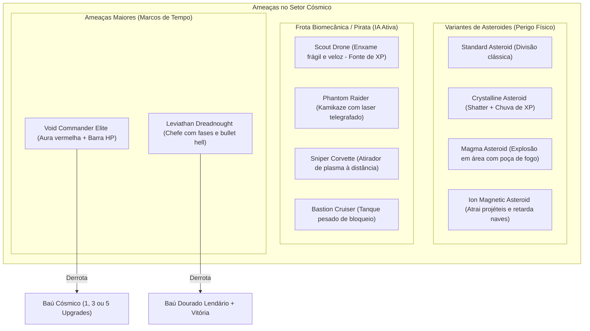

# Astra Valkyries // Ecossistema de Inimigos, Bosses & Sistema de Baús

> [!IMPORTANT]
> Este documento define a transição do modelo básico de asteroides passivos para o padrão completo dos grandes expoentes do gênero *Bullet Heaven / Survivor* (*Vampire Survivors*, *Brotato*, *Nova Drift*). 
> Ele introduz **IA ativa de combate**, **variantes exóticas de asteroides**, **elites com barras de vida** e o viciante **Loop de Recompensa de Baús**.

---

## 1. O Diagnóstico: Por que apenas asteroides não sustentam a retenção?

Em *Asteroids (1979)*, o desafio vinha apenas da física inercial e de rochas que se quebravam em linha reta. No entanto, na fórmula moderna de *Bullet Heaven*:
- **Inimigos precisam forçar decisões de navegação:** Alguns devem encurralar em massa (swarms), outros devem obrigar esquiva rápida (chargers/kamikazes), outros devem atirar à distância (snipers).
- **Ruptura de Ritmo e Picos de Dopamina:** Derrotar inimigos resistentes (Elites/Chefes) precisa ser recompensado com **Baús Cósmicos** (*Jackpot Chests*) que entregam múltiplos upgrades simultâneos e evoluções de armas.
- **Leitura Visual Clara:** Cada tipo de ameaça tem cor, silhueta e som característicos, permitindo que o jogador priorize alvos intuitivamente pelo canto do olho na tela do celular.

---

## 2. A Matriz de Inimigos e Ameaças



---

## 3. Detalhamento das Entidades

### 3.1 Variantes de Asteroides (Perigos Ambientais)
Todos desenhados em **computação vetorial procedimental (`Canvas`)**, sem necessidade de sprites pesados:

| Tipo | Visual / Cor | Comportamento ao Dano / Morte | Recompensa |
| :--- | :--- | :--- | :--- |
| **Padrão** | Cinza rochoso clássico | Divide-se em pedaços médios e pequenos | Stardust XP normal |
| **Cristalino** | Prisma geométrico Ciano/Violeta com brilho neon | Não se divide; explode em 16 estilhaços afiados | **Chuva massiva de Stardust XP** |
| **Magma / Vulcânico** | Rocha negra com veias laranja incandescentes | Ao quebrar, cria uma onda de choque que queima naves e destrói outros meteoros próximos | Ótimo para combos de explosão |
| **Iônico / Magnético** | Rocha azul com arcos elétricos | Gera um campo que atrai a jogadora e curva a trajetória dos tiros | Risco tático / Zona de cautela |

---

### 3.2 Frotas Inimigas com Inteligência Artificial (Inimigos Ativos)

Diferente dos asteroides, as naves inimigas navegam ativamente pelo setor:

1. **Scout Drone (Enxame de Sucata)**:
   - **Arquétipo**: O "morcego" de Vampire Survivors.
   - **Comportamento**: Spawna em grupos de 5 a 12 unidades nas bordas. Voa em linha reta acelerando na direção do jogador com pouca vida (1 a 2 tiros).
   - **Função**: Alimentar o jogador com XP constante e criar aquela sensação gostosa de "limpeza de tela" quando as armas disparam.

2. **Phantom Raider (Kamikaze Veloz)**:
   - **Arquétipo**: Perigo de colisão direta.
   - **Comportamento**: Trava a mira na piloto com uma linha de laser telegrafada por 0.8s, ativa propulsores vermelhos e dispara numa investida veloz.
   - **Contra-ataque**: Exige o uso do **Dash** no momento certo para esquivar.

3. **Sniper Corvette (Atirador de Plasma)**:
   - **Arquétipo**: Inimigo de longa distância.
   - **Comportamento**: Mantém uma distância segura da nave da jogadora e dispara esferas de plasma luminosas lentas a cada 2.5s.
   - **Função**: Obriga o jogador a não ficar parado em círculos e esquivar de projéteis ativos.

4. **Armored Bastion (Tanque de Vanguarda)**:
   - **Arquétipo**: Bloqueador / Esponja de Dano.
   - **Comportamento**: Nave hexagonal massiva com blindagem frontal refletora. Avança lentamente, aglomerando enxames atrás de si.

---

### 3.3 Inimigos de Elite e Minibosses (A cada 1:30 ou 3:00)

1. **Void Commander (Elite Miniboss)**:
   - Surge com um alarme tático no HUD: `⚠️ ELITE TARGET DETECTED`.
   - Possui aura pulsante vermelha/dourada e barra de vida sobre o casco.
   - Dispara padrões circulares de tiros e tenta cercar o jogador.
   - **Drop Garantido**: **Baú Cósmico (Void Chest)**.

2. **Dreadnought Leviathan (Chefe de Setor)**:
   - Encontro monumental ao final da run.
   - Possui 2 a 3 fases de combate:
     - *Fase 1*: Disparo de barragens de torpedos e lasers orbitais telegrafados.
     - *Fase 2*: Invocação de escolta de drones e anéis de fogo cruzado.
   - Vitória concede conclusão da Sortie, grandes quantias de créditos e ilustrações/desbloqueios no Hangar.

---

## 4. O Sistema de Baús de Dopamina (*Jackpot Chests*)

O baú é a alma de *Vampire Survivors*. Ele quebra a tensão do combate com uma explosão de recompensa:

```
[ Inimigo Elite Derrotado ]
         ↓
[ Baú Holográfico Dourado Surge no Espaço ]
         ↓
[ Jogadora Navega até o Baú e Coleta ]
         ↓
[ Ação Congela Dramaticamente + Som de Vitória Estelar ]
         ↓
[ Overlay Animado: Abertura Sci-Fi do Baú ]
         ↓
[ Rolagem de Prêmios: 1x, 3x ou 5x Cartas de Upgrades Instantâneos! ]
         ↓
[ Retorno Imediato à Ação com Arsenal Super-Carregado ]
```

- **Tipos de Baú**:
  - **Baú Padrão (Prata)**: 1 Upgrade garantido + Stardust bônus.
  - **Baú Raro (Ouro - 15% de chance)**: 3 Upgrades de uma vez!
  - **Baú Lendário (Jackpot Cósmico - 5% de chance)**: 5 Upgrades + Evolução Imediata de Arma para MK MAX!

---

## 5. Cronograma Modular de Implementação

- **Etapa 1**: Classe base `EnemyShipComponent` + Comportamento de Scout Drone (Enxames de XP).
- **Etapa 2**: Inimigo Atirador (Sniper Corvette com projéteis hostis) e Kamikaze (Phantom Raider com mira telegrafada).
- **Etapa 3**: Variantes de Asteroides (Cristalino com chuva de XP e Magma explosivo).
- **Etapa 4**: Inimigo Elite com barra de vida + Entidade do Baú Cósmico e Overlay de Abertura (*Jackpot Modal*).
- **Etapa 5**: Gerador de Ondas Baseado em Tempo (*Timeline Spawner* substituindo o spawner aleatório atual).
