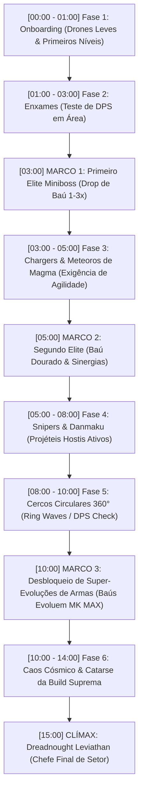
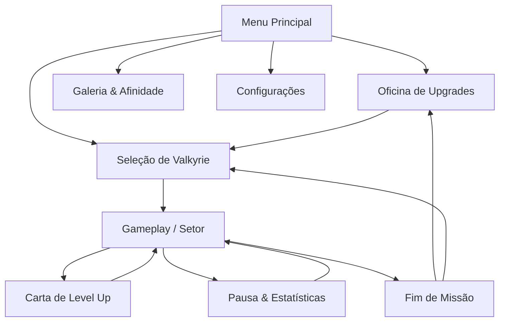

# Game Design Document (GDD)

**Versão do Documento:** 0.1  
**Autor:** Mateus & Equipe de Desenvolvimento  
**Data:** 04/11/2026  
**Status do Projeto:** Pré-Produção / Planejamento  

---

# 1. Projeto e Visão Geral do Jogo

---

## ⇒ 1.1 High Concept (Conceito Geral)
*Astra Valkyries: Void Protocol* é um bullet-heaven / space roguelite frenético que funde a física inercial clássica de *Asteroids* com a progressão viciante de *Vampire Survivors*, ambientado em uma guerra cósmica intergaláctica protagonizada por comandantes e pilotos de anime (estética sci-fi ecchi/waifu) com arte 2D deslumbrante, diálogos dinâmicos e sistema de afinidade.

## ⇒ 1.2 Game Overview (Visão Geral do Jogo)
O jogador assume o comando da nave capitânia *Astra Horizon*, enfrentando ondas implacáveis de asteroides cósmicos, enxames de drones biomecânicos e frotas alienígenas em setores espaciais gerados proceduralmente. Destruir ameaças gera núcleos de plasma (Stardust/XP) que sobem de nível em tempo real, permitindo a escolha entre cartas de melhoria e sinergias de armas. Fora das partidas (*meta-game*), o jogador utiliza a sucata interestelar para comprar melhorias permanentes na Oficina e destravar pilotos, trajes, ilustrações exclusivas e novas naves na ala das Valkyries.

## ⇒ 1.3 Título do Jogo
**Título Principal:** *Astra Valkyries: Void Protocol*  
*(Alternativa Comercial: Stellar Sirens: Survivors)*

## ⇒ 1.4 O que faz dele único?
1. **Física Espacial Inercial + Bullet Heaven:** Ao contrário dos clones tradicionais de Vampire Survivors em planos 2D estáticos, o controle possui aceleração vetorial, drift cósmico, impulso de reatores e gravidade de corpos celestes.
2. **Combinação de Shmup Clássico com Deckbuilding:** Armas de tiro omnidirecional, drones de suporte orbitais, canhões laser contínuos e escudos defletores que se fundem em "Super-Armas" (Evoluções).
3. **Loop Ecchi / Anime Altamente Lucrativo na Steam:** Pilotos com dublagem parcial em japonês/inglês, retratos expressivos que reagem ao perigo (*Battle Damage* estético moderado e desbloqueios de galeria/fan-service no hangar sem interferir na gameplay hardcore).

## ⇒ 1.5 Principais Gameplay Features (Recursos de Jogabilidade)
- **Partidas Rápidas e Intensas (Runs de 15 a 20 minutos):** Sobrevivência contra ondas cronometradas com chefes titânicos ao final de cada setor.
- **Mais de 30 Armas e Acessórios Sinergéticos:** Lasers de fase, mísseis quânticos, drones de defesa, orbes de singularidade e raios criogênicos.
- **Sistema de Fases em Biomas Procedurais:** Setor de Cinturão de Asteroides, Nebulosa Tóxica (névoa e dano contínuo sem escudo), Campo de Ruínas de Frotas e Núcleo do Buraco Negro.
- **Oficina de Meta-Progressão (Hangar):** Compra permanente de estatísticas base (Vida do Casco, Ímã de Coleta, Penetração, Recarga, Velocidade de Giro e Sorte).
- **Quartel das Valkyries (Afinidade & Galeria):** Conversas com as comandantes após cada run, presentes estelares e desbloqueio de artes e trajes alternativos.

---

# 2. Público-alvo e Plataformas

---

## ⇒ 2.1 Público-alvo
- **Primário:** Jogadores de PC fãs de Roguelikes e Action Roguelites (*Vampire Survivors*, *Brotato*, *Halls of Torment*, *Nova Drift*).
- **Secundário:** Comunidade otaku e entusiastas de jogos anime/ecchi da Steam que apreciam arte de alta qualidade, waifus carismáticas e progressão de coleção (*Azur Lane*, *Nikke*, *HuniePop*, *Senran Kagura*).
- **Faixa Etária:** 18+ (para acomodar arte ecchi/fanservice e opções sem censura).

## ⇒ 2.2 Plataformas
- **Lançamento Inicial:** PC (Steam e Itch.io).
- **Compatibilidade Nativa:** Total suporte a Gamepad (Xbox/PlayStation) e Steam Deck (Meta: 60 FPS estáveis com baixo consumo de bateria).

## ⇒ 2.3 Gênero do Jogo
Space Action Roguelite / Bullet Heaven / 2D Sci-Fi Shmup com elementos de Visual Novel.

## ⇒ 2.4 Modelo de Negócios
- **Preço Base (Premium B2P):** $4.99 USD a $7.99 USD na Steam (R$ 16,99 a R$ 24,99 no Brasil com paridade regional).
- **Lançamento:** Acesso Antecipado (*Early Access*) com 3 Valkyries e 3 Biomas, escalando para 1.0 com 6 Valkyries e chefes finais.
- **Pós-lançamento:** DLCs de Expansão com novas personagens, dublagens, biomas e pacotes de skins cosméticas. Zero microtransações agressivas ou pay-to-win.

---

# 3. Produção

---

## ⇒ 3.1 Protótipo
- **Duração:** 3 semanas.
- **Escopo:** Validação do loop central: navegação inercial com mouse/teclado e joystick, spawn de asteroides e drones básicos, coleta de orbes de XP, tela de level up com 6 cartas simples funcionais.

## ⇒ 3.2 Pré-alpha
- **Duração:** 4 semanas.
- **Escopo:** Integração da primeira Valkyrie (comandante com retrato animado e HUD), 12 armas/acessórios, sistema de evolução de arma básica e primeiro chefe (Super Fragata Alienígena).

## ⇒ 3.3 Versão Alpha
- **Duração:** 6 semanas.
- **Escopo:** 3 Valkyries jogáveis com habilidades ativas exclusivas, 2 Biomas (Cinturão Espacial e Nebulosa), Árvore de Meta-Upgrades da Loja completamente funcional e sistema de áudio/música implementado.

## ⇒ 3.4 Versão Beta
- **Duração:** 4 semanas.
- **Escopo:** Balanceamento de sinergias, sistema de Galeria/Afinidade no menu, suporte completo a conquistas da Steam, salvamento em nuvem (*Steam Cloud*) e testes de estabilidade em altas densidades de partículas.

## ⇒ 3.5 Versão Closed Beta
- **Duração:** 2 semanas.
- **Escopo:** Distribuição de chaves Steam para criadores de conteúdo de roguelike e influenciadores de jogos de anime para coleta de telemetria, feedback de balanceamento e relatórios de bugs.

## ⇒ 3.6 Versão Release Candidate (RC)
- **Duração:** 1 semana.
- **Escopo:** Build final polida, sem bugs críticos conhecidos, tradução PT-BR, EN, JA e ZH simplificado, testes no Steam Deck (verificação verde/amarela da Valve).

## ⇒ 3.7 Versão Gold
- **Escopo:** Publicação na Steam Store e Itch.io com trailer cinemático de lançamento e ativação da campanha de marketing.

---

# 4. Jogabilidade I: OCR e 3Cs

---

## ⇒ 4.1 Objective, Challenge e Reward - OCR

### ⇒ 4.1.1 Objective
- **Curto Prazo:** Esquivar de corpos celestes e projéteis inimigos, coletando Cristais de Plasma para subir de nível e montar uma build sinérgica.
- **Médio Prazo:** Sobreviver às ondas cronometradas de 5, 10 e 15 minutos até a chegada do Cruzador Chefe de cada setor.
- **Longo Prazo:** Derrotar o chefe final da run, coletar Núcleos de Matéria Escura para a Oficina, desbloquear novas Valkyries e completar a Galeria de Memórias.

### ⇒ 4.1.2 Challenge
- Aceleração inercial: saber a hora de usar o contra-empuxo para não deslizar em direção a um enxame.
- Densidade exponencial de projéteis e asteroides dividindo-se no espaço.
- Inimigos com mecânicas específicas: interceptadores velozes, cruzadores com raio laser de corte contínuo e minas magnéticas.

### ⇒ 4.1.3 Reward
- Explosões visuais gratificantes com efeitos sonoros encorpados e telas limpas de inimigos em cascata.
- Seleção de cartas épicas e lendárias ao subir de nível.
- Desbloqueio de diálogos de afeto, ilustrações especiais e trajes das Valkyries ao atingir metas e recordes.

## ⇒ 4.2 Camera, Character e Control - 3 Cs

### ⇒ 4.2.1 Câmera
- Câmera 2D Top-Down com suavização linear (*camera lerp*), acompanhando a nave do jogador.
- Zoom dinâmico que se afasta sutilmente em altas velocidades ou quando chefes massivos entram na tela, aumentando o campo de visão tático.

### ⇒ 4.2.2 Personagem
- A nave do jogador possui identidade visual vinculada à Valkyrie escolhida (ex: nave ágil interceptadora para a piloto de assalto, nave pesada com escudos reforçados para a comandante de defesa).
- Piloto expressa reações sonoras e visuais (mini-avatar na HUD) ao receber dano crítico, atingir combos altos ou ativar o ataque supremo.

### ⇒ 4.2.3 Controle
- **Opção A (Twin-Stick / Gamepad):** Analógico esquerdo move e rotaciona a nave; gatilho direito ou analógico direito mira o disparo; botão de propulsor auxiliar (Boost/Dash) e botão de Habilidade Suprema.
- **Opção B (Teclado + Mouse):** WASD para movimentação e rotação direcional; Cursor do mouse para mira precisa; Barra de espaço para Boost; E / Q para Habilidade Suprema.
- **Disparo Automático Configurável:** Opção de mira automática nos alvos mais próximos para acessibilidade, alternável a qualquer momento.

---

# 5. Jogabilidade II: Regras e Estrutura do Jogo

---

## ⇒ 5.1 Quais as principais habilidades exigidas no jogo?
- **Tomada de Decisão Estratégica:** Escolha de itens com sinergia durante o level-up (adaptar a build com base nas opções oferecidas).
- **Consciência Espacial e Posicionamento:** Controlar a inércia em ambientes cercados sem bater em obstáculos ou paredes invisíveis do setor.
- **Reflexo e Gerenciamento de Risco:** Saber quando mergulhar no meio de um enxame para coletar um ímã ou núcleo raro versus recuar e atirar à distância.

## ⇒ 5.2 Que tipo de experiência você quer passar com o seu jogo?
Uma sensação progressiva que vai da vulnerabilidade inicial cautelosa até se tornar um verdadeiro deus cósmico bélico, destruindo milhares de naves estelares por minuto em uma sinfonia neon de lasers e explosões, tudo isso impulsionado pelo charme e apego emocional aos pilotos.

## ⇒ 5.3 Quais motivações você vai apresentar para os seus jogadores?
- **Poder Imediato:** Sentir a diferença brutal de força a cada arma evoluída durante a partida.
- **Colecionismo e Conteúdo Adulto/Anime:** O desejo de descobrir todos os eventos de conversa e ilustrações secretas de cada Valkyrie.
- **Conquistas e Maestria:** Superar modificadores de dificuldade (*Curse / Void Torment*) para os jogadores hardcore.

---

# 6. Jogabilidade III: Fluxo

---

## ⇒ 6.1 Para garantir a variedade e ritmo do jogo, quais são as suas mecânicas auxiliares e modificadores no jogo?
- **Anomalias de Setor:** Chuvas de meteoritos gravitacionais, tempestades solares que afetam o escudo temporariamente ou portais de fendas de hiperespaço com baús de tesouro.
- **Drones de Apoio Orbitais:** Equipamentos passivos que giram em torno da nave, bloqueando projéteis ou disparando raios independentes.
- **Dash de Hiperespaço:** Janela de invulnerabilidade com tempo de recarga para atravessar paredes de balas e asteroides.

## ⇒ 6.2 Quais são as recompensas no jogo?
- **Em Partida:** Cristais de Stardust (XP), Baús de Elite (concedem de 1 a 5 upgrades simultâneos e ouro), Itens de Uso Imediato (Bomba de Fótons que limpa a tela, Ímã Cósmico total, Restauração de Casco).
- **Meta-Jogo:** Sucata Estelar (moeda para árvore de atributos), Fragmentos de Memória (para destravar arte e histórias) e Insígnias de Batalha (para skins e novas armas iniciais).

## ⇒ 6.3 Quais são os seus inimigos e desafios no jogo?
Baseado na taxonomia de sucesso do gênero *Bullet Heaven* (*Vampire Survivors*, *Brotato*), as ameaças dividem-se em 3 pilares complementares:

### 1. Variantes de Asteroides (Perigos Ambientais Vetoriais):
- **Asteroide Padrão:** Rocha cinza clássica que fragmenta em pedaços médios e pequenos ao ser destruída.
- **Prisma Cristalino:** Rocha facetada brilhante neon que não se divide, mas explode em 16 fragmentos e libera uma **chuva massiva de Stardust XP**.
- **Asteroide de Magma:** Rocha incandescente que cria uma onda de calor e poça de fogo estelar ao morrer, incinerando naves próximas.
- **Asteroide Iônico / Magnético:** Gera um campo gravitacional que curva disparos e atrai naves descuidadas.

### 2. Frota Biomecânica / Pirata (Inimigos com IA Ativa):
- **Scout Drone (Enxame / Fodder):** Naves triangulares ágeis e frágeis (1 a 2 tiros) que surgem em bandos de 10 a 20 unidades. Servem como a fonte primária e prazerosa de coleta contínua de XP.
- **Phantom Raider (Charger / Kamikaze):** Caça veloz que projeta uma linha de mira laser telegrafada por 0.8s e dispara em investida supersônica. Exige o uso do **Dash** para evasão.
- **Corvette Sniper (Atirador à Distância):** Mantém distância de segurança e cospe esferas lentas de plasma luminoso a cada 2.5s, forçando movimentação ativa.
- **Bastion Cruiser (Tanque Pesado):** Hexágono blindado resistente a repulsões (*knockback*), aglomerando hordas atrás de sua couraça.

### 3. Ameaças de Elite e Chefes de Setor:
- **Void Commander (Elite Miniboss):** Surge com sirene de alerta (`⚠️ ELITE TARGET DETECTED`), aura pulsante e barra de vida sobre o casco. Ao ser destruído, garante o drop do **Baú Cósmico (Jackpot)**.
- **Dreadnought Leviathan (Chefe de Setor):** Combate monumental em múltiplas fases (torpedos teleguiados, lasers orbitais giratórios e invocações de frotas).

## ⇒ 6.4 Qual o tipo de fluxo do seu jogo?
O ritmo do jogo abandona o spawn puramente aleatório e adota o **Timeline Script Cronometrado (Clock-Driven Wave Design)** consagrado por *Vampire Survivors*:

---

# 7. Jogabilidade IV: Sistema e Protótipo

---

## ⇒ 7.1 Faça uma lista com o mínimo de 3 Signs (sinais) e 3 Feedbacks (retornos) do seu jogo

### Signs (Sinais de Alerta ao Jogador):
1. **Linha de Mira Vermelha/Laser de Trava:** Inimigo atirador de elite telegrafa a direção do disparo 1,2 segundo antes de atirar.
2. **Círculo de Pulso com Sirene:** Zona de colapso de dobra espacial indicando onde um meteoro gigante ou nave chefe vai surgir.
3. **Borda da Tela em Chamas/Alerta Vermelho:** Casco da nave abaixo de 25% de vida com voz da Valkyrie alertando: *"Alerta de integridade crítica!"*.

### Feedbacks (Retornos Imediatos às Ações):
1. **Flash Branco e Recuo de Impacto:** Ao acertar inimigos, eles piscam em branco por 0.05s com números flutuantes de dano crítico em cores diferenciadas.
2. **Screen Shake Moderado e Freeze Frame:** Ao explodir grandes asteroides ou chefes, há uma desaceleração microscópica (3 frames) e tremor suave de tela transmitindo impacto real.
3. **Absorção Magnética Suave:** Cristais de XP aceleram em curva suave em direção à nave com trilha brilhante e som harmônico em tom ascendente conforme a sequência de coleta.

## ⇒ 7.2 Se você fosse criar o protótipo do seu jogo, quais as 3 mecânicas que você gostaria de validar?
1. **Controle inercial de navegação:** Verificar se a pilotagem com física espacial se mantém divertida e não frustrante durante o caos de um bullet heaven.
2. **Curva de drop e magnetismo de XP:** Validar a taxa de subida de nível para que a escolha de cartas ocorra a cada 25 a 45 segundos nos primeiros 5 minutos.
3. **Sinergia e legibilidade visual de 4+ armas disparando simultaneamente:** Garantir que o jogador ainda consiga ler os projéteis inimigos em meio ao seu próprio poder de fogo.

---

# 8. Mecânicas

---

## ⇒ 8.1 Descreva a mecânica principal do seu jogo
O jogador controla uma nave espacial em um plano 2D com gravidade zero e inércia vetorial. Armas instaladas disparam de forma autônoma ou direcionada em alvos no alcance. Inimigos e corpos celestes destruídos soltam Cristais de Stardust que, ao serem atraídos e absorvidos pelo raio magnético da nave, preenchem a barra de experiência do setor. Ao completar a barra, o jogo congela momentaneamente e oferece uma escolha entre 3 a 4 cartas de melhoria de equipamento.

## ⇒ 8.2 Liste 3 regras do seu jogo
1. **Morte Permanente na Run:** Se os pontos de vida da nave chegarem a zero, a run termina imediatamente; toda a XP do setor é perdida, mas toda a Sucata e Fragmentos coletados são mantidos para a Oficina.
2. **Limite de Slots de Arsenal (Padrão Vampire Survivors):** Cada nave suporta no máximo 6 Armas Ativas e 6 Itens Passivos simultâneos, forçando decisões estratégicas de build e sinergias de combate.
3. **Regra de Evolução de Super-Arma & Baús de Dopamina:**
   - Para evoluir uma arma, ela deve atingir o **Nível Máximo (MK MAX / Lv 8)** e a piloto deve possuir o **Acessório Passivo de Sinergia** correspondente no inventário (ao menos Lv 1).
   - A evolução só é liberada a partir da coleta de um **Baú Cósmico** derrubado por um Inimigo Elite ou Chefe após o marco de tempo de evolução.
   - **Mecânica de Sorte (Sequential Roll):** Ao abrir um baú, o jogo testa sequencialmente a chance de 5 itens (Jackpot), depois 3 itens e por fim 1 item, multiplicado pelo atributo de Sorte (*Luck*) da piloto.
   - **Regra de Beginner's Luck:** Nos primeiros 6 baús abertos de um novo jogador, o sistema garante a sequência fixa `[1, 1, 3, 1, 1, 5]` para introduzir a dopamina do Jackpot.

## ⇒ 8.3 Liste 3 parâmetros que você vai utilizar na sua mecânica principal
1. `inertia_drag` (Coeficiente de atrito no vácuo / amortecimento linear da nave, ex: 0.94).
2. `magnet_radius` (Raio em pixels de atração dos orbes de plasma, expansível via atributos).
3. `xp_orb_consolidation_cap` (Teto de 60 orbes de XP simultâneos no canvas mobile. O excesso de XP é acumulado em um único **Orbe Vermelho / Hiper-Stardust** distante, garantindo 60 FPS cravados sem engasgos).

---

# 9. Level Design I: Tutorial e Progressão

---

## ⇒ 9.1 Tipo de tutorial você vai utilizar
**Tutorial Orgânico Não-Intrusivo ("Show, Don't Tell"):**
- No primeiro minuto da primeira partida, o jogador surge em uma área tranquila do espaço com apenas um asteroide inerte e dicas flutuantes discretas de botões (WASD / Stick).
- O primeiro asteroide destruído garante XP suficiente para o primeiro level-up garantido, ensinando a interface de cartas.
- Inimigos fracos e lentos entram em pequenos grupos antes do cronômetro de sobrevivência principal disparar.

## ⇒ 9.2 Power-ups (se houver)
- **Drops Temporários do Campo de Batalha:**
  - *Hiper-Reator (Overdrive):* Cadência de tiro aumentada em 100% por 8 segundos.
  - *Pulso de Singularidade:* Atrai instantaneamente todo o Stardust presente no mapa inteiro para a nave.
  - *Carga de Antimatéria:* Detona todos os inimigos normais na tela.
  - *Nanitas Reparadores:* Restaura 30% da integridade do casco da nave.

---

# 10. Level Design II: Níveis de Dificuldade

---

## ⇒ 10.1 Níveis de dificuldade que o player irá enfrentar
1. **Setor 1 (Cinturão de Kuiper - Iniciante):** Asteroides clássicos, drones mecânicos lentos, tempo de run: 15 minutos.
2. **Setor 2 (Nebulosa de Órion - Intermediário):** Visibilidade reduzida, gases cósmicos com zonas de lentidão, interceptadores kamikaze com escudos energéticos.
3. **Setor 3 (Cemitério de Cruzadores - Difícil):** Destroços metálicos indestrutíveis que exigem pilotagem fina, frotas inimigas organizadas com canhões de plasma.
4. **Modo Tormento Cósmico (Endgame):** Modificadores opcionais selecionáveis pelo jogador antes da run (+Velocidade dos Inimigos, +Vida dos Inimigos, Menos Cura, Spawn Duplo de Chefes) oferecendo multiplicador de Sucata Estelar de até 300%.

## ⇒ 10.2 Níveis de habilidade que ajudará o player
- Habilidades desbloqueáveis na Oficina da Comandante:
  - *Tier 1:* Vida Máxima, Regeneração de Casco, Velocidade de Movimento.
  - *Tier 2:* Raio Magnético, Cadência de Disparo, Dano Crítico.
  - *Tier 3:* Reroll de Cartas, Descarte de Opção (*Banish*), Trava de Carta (*Lock*), Vida Extra (Ressurreição automática).

---

# 11. Level Design III: Comportamento dos Inimigos

---

## ⇒ 11.1 Liste o comportamento de todos os inimigos
A taxonomia de inimigos segue os papéis de gameplay consagrados em *Vampire Survivors*, garantindo dinamismo e exigência tática:

### 1. Perigos Ambientais (Variantes de Asteroides):
1. **Asteroide Rochoso Comum:** Flutua em trajetória inercial fixa; ao receber dano letal, quebra em 2 pedaços médios; estes quebram em 2 pedaços pequenos. Fonte estável de Stardust.
2. **Prisma Cristalino:** Rocha geométrica ciano/violeta com casca reflexiva; não se fragmenta, mas implode em 16 estilhaços afiados e libera uma **chuva torrencial de Stardust XP**.
3. **Asteroide de Magma:** Rocha vulcânica preta com veias incandescentes. Ao ser destruída, cria uma poça de plasma térmico que causa dano em área contínuo por 3.5 segundos em naves e outros meteoros.
4. **Asteroide Iônico:** Emite arcos magnéticos que distorcem trajetórias de tiros e atraem o caça em direção ao seu epicentro.

### 2. Frota Biomecânica Hostil (IA Ativa de Combate):
5. **Scout Drone (Swarmer / Fodder):** Spawna em bandos contínuos de 10 a 20 naves leves nas bordas. Acelera em perseguição direta; morre com 1 ou 2 disparos, criando a sensação viciante de "ceifar multidões" e garantindo fluxo constante de XP.
6. **Phantom Raider (Charger / Kamikaze):** Caça stealth vermelho. Trava a mira no caça da jogadora com uma linha laser telegrafada por 0.8s e dispara uma investida a 250% da velocidade base. Exige o uso do **Dash** para evasão.
7. **Corvette Sniper (Atirador à Distância):** Permanece na meia-distância (fora do alcance do auto-fire de curto alcance) e dispara orbes lentos de plasma a cada 2.5s.
8. **Bastion Cruiser (Tanque Pesado de Bloqueio):** Casco hexagonal massivo, imune a empurrões (*knockback*). Absorve fogo concentrado e cria uma barreira física que bloqueia as rotas de fuga da piloto.

### 3. Elites e Chefes de Setor:
9. **Void Commander (Elite Miniboss):** Spawna nos marcos de 3:00 e 5:00. Possui aura neon pulsante, barra de vida destacada no topo e dispara leques de projéteis em espiral. **Drop Garantido:** Baú Cósmico de Dopamina (Jackpot com 1 a 3 upgrades).
10. **Dreadnought Leviathan (Chefe Final de Setor):** Confronto culminante aos 15:00. Possui 3 fases com padrões telegrafados de Danmaku, feixes de laser orbital que cortam o canvas e invocações de frotas de apoio. Vitória garante a conclusão da Sortie e Baú Dourado Lendário.

---

# 12. Level Design IV: Balanceamento

---

## ⇒ 12.1 Liste os sistemas de mecânicas que poderão receber balanceamento durante o jogo
1. **Curva de Exigência de XP (Progressão Exponencial Suave):**
   Fórmula de XP por nível calibrada para subidas rápidas no início (níveis 1 a 5 em menos de 2 minutos) e espaçamento estratégico no mid-game:
   $$XP_{req}(N) = 24 + (N - 1) \times 28 + (N^2 \times 6)$$
2. **Matemática do Baú Cósmico & Atributo de Sorte (Luck):**
   - Chance Base de 5 Itens (Super Baú): $5\% \times \text{Luck}$
   - Chance Base de 3 Itens (Baú Ouro): $20\% \times \text{Luck}$
   - Fallback: 1 Item (Baú Prata)
   - *Beginner's Luck:* Primeiros 6 baús forçam a sequência `1, 1, 3, 1, 1, 5`.
3. **Teto de Otimização Mobile & Consolidação de XP (Red Gem Siphon):**
   - Limite de 38 a 45 inimigos simultâneos na tela para manter 60 FPS cravados em processadores intermediários móveis.
   - Limite de 60 orbes de XP no canvas. Quando atingido, o orbe mais distante absorve silenciosamente todo o XP excedente e transforma-se no **Orbe Hiper-Stardust Vermelho**, garantindo zero perda de progressão.
4. **DPS e Sinergias de Super-Armas:**
   Atingir o nível 8 (MK MAX) de uma arma e possuir o acessório passivo correspondente desbloqueia a evolução no próximo baú, elevando o DPS em até 350% para compensar a escalada de HP dos inimigos do final da fase.
5. **Hitbox Reduzida e Tolerância de Colisão:**
   A hitbox da nave é calibrada com 45% do diâmetro visual do caça, permitindo que a jogadora "costure" por entre frentes densas de tiros e meteoros sem frustração.

---

# 13. História e Narrativa

---

## ⇒ 13.1 Defina o estilo da narrativa do jogo
Narrativa sci-fi descontraída com toques de comédia, romance e drama leve no estilo de visual novel japonesa moderna. A história progride através de transmissões de rádio durante a partida e diálogos no hangar após cada retorno à nave-mãe.

## ⇒ 13.2 Em até 2 parágrafos, resuma como será a história do jogo
No ano estelar 3042, uma anomalia cósmica conhecida como "O Vazio Devorador" despertou enxames biomecânicos e desestabilizou o cinturão de asteroides do quadrante Terminus. O jogador assume o posto de Comandante da última estação de pesquisa avançada, liderando o esquadrão das *Astra Valkyries* — garotas geneticamente aprimoradas e prodígios da pilotagem, cada uma com sua própria personalidade cativante, segredos e estilos de combate.

Enquanto desbravam os setores corrompidos para salvar o quadrante e recolher amostras de núcleos cósmicos, o jogador constrói laços de confiança e afeição com suas pilotos. Entre missões intensas no vácuo e pausas de descanso na câmara de descompressão e no lounge da base, descobre-se que a anomalia do Vazio está ligada ao passado esquecido da mais misteriosa das Valkyries.

## ⇒ 13.3 Divida a história do seu jogo em arcos, use a técnica de outline
- **Arco 1: O Despertar do Vazio (Setor 1)**
  - Introdução com a piloto novata e enérgica *Lyra* (especialista em propulsão rápida e armas vulcan).
  - Investigação de sinais anômalos no cinturão de mineração local.
  - Vitória sobre o primeiro drone corrompido e resgate dos dados do protocolo secreto.
- **Arco 2: Ecos na Nebulosa (Setor 2)**
  - Apresentação da comandante tática e reservada *Selene* (especialista em escudos de plasma e lasers de precisão).
  - Viagem através da Nebulosa Tóxica em busca de uma estação científica abandonada.
  - Revelação de que as naves inimigas usam a mesma tecnologia dos reatores das próprias Valkyries.
- **Arco 3: O Coração do Colapso (Setor 3 & Clímax)**
  - Desbloqueio da piloto veterana e excêntrica *Kagura* (especialista em canhões de singularidade pesados).
  - Invasão à nave-mãe alienígena no horizonte de eventos de um buraco negro.
  - Batalha final, redenção e desbloqueio da rota verdadeira com finais e memórias especiais para cada garota.

---

# 14. Arte e Estética

---

## ⇒ 14.1 Defina o estilo de arte e estética do jogo
- **Arte dos Personagens:** Anime 2D de altíssima fidelidade com traços limpos e coloração rica, com ilustrações dinâmicas de expressões faciais na HUD e retratos completos em formato Visual Novel nos menus.
- **Ambiente de Gameplay:** Estética Sci-Fi Neon Retrofuturista com fundos cósmicos profundos (nebulosas coloridas, estrelas em paralaxe), sprites nítidos de naves espaciais e partículas luminosas com efeito *bloom* e trilhas de brilho.
- **Estética Ecchi/Fanservice:** Roupas de piloto futuristas e elegantes com detalhes justos, pequenos cortes e reações de rubor/expressão quando a nave sofre dano crítico, e ilustrações desbloqueáveis de trajes casuais, praia ou banho na galeria de recompensas.

## ⇒ 14.2 Descreva brevemente a arte do jogo usando referências visuais
- Personagens: Estilo inspirado em ilustrações de *Azur Lane*, *Goddess of Victory: Nikke* e *Honkai Impact 3rd*.
- Gameplay e Naves: Visual vetorizado e nítido inspirado em *Nova Drift*, com paleta de cores vivas e explosões neon lembrando *Geometry Wars* e *Vampire Survivors*.

## ⇒ 14.3 Desenvolva a direção de arte do jogo
- **Paleta de Cores Primárias:** Ciano elétrico, magenta cósmico, amarelo plasma e azul marinho profundo no espaço.
- **Iluminação & Pós-processamento:** Glow/Bloom vibrante em tiros e explosões; linhas de distorção no espaço durante o uso do turbo ou do salto de hiperespaço.
- **UI:** Menus futuristas limpos e elegantes em tons escuros e acentos holográficos azuis e roxos, mantendo os retratos dos personagens em destaque aconchegante.

---

# 15. UI/UX Interface do Usuário

---

## ⇒ 15.1 Liste todas as telas de interface do usuário incluindo HUD
1. **Tela de Título / Menu Principal:** Iniciar Jornada, Hangar/Oficina, Quartel das Valkyries (Galeria), Configurações, Créditos, Sair.
2. **Hangar / Loja de Meta-Progressão:** Grade de atributos com nós de compra por Sucata Estelar, com botão de reembolso gratuito (*Respec*).
3. **Seleção de Valkyrie e Nave:** Escolha da piloto ativa, visualização de estatísticas iniciais, arma nativa e prévia do retrato 2D.
4. **Gameplay HUD:**
   - Barra de Vida do Casco e Barra de Escudo de Força no topo esquerdo.
   - Retrato interativo da Valkyrie ao lado da barra com expressões animadas.
   - Barra horizontal no topo de Progresso de XP do Nível atual.
   - Ícones das 6 armas ativas e 6 itens passivos equipados no canto inferior esquerdo.
   - Cronômetro da run e contador de abates no topo central.
   - Indicador de recarga do Dash/Especial no canto inferior direito.
5. **Tela de Level-Up (Overlay congelante):** Apresentação de 3 ou 4 cartas ilustradas com nome, raridade, ícone e descrição clara do efeito numérico.
6. **Tela de Pausa:** Resumo completo de status, armas atuais, lista de sinergias já conhecidas e opções de volume/gráficos.
7. **Tela de Fim de Missão (Vitória / Derrota):** Estatísticas detalhadas de dano por arma, Sucata acumulada, tempo de sobrevivência e botão de retorno à base.
8. **Galeria de Memórias / Lounge:** Galeria interativa de ilustrações desbloqueadas com zoom e leitor de diálogos românticos/cômicos.

## ⇒ 15.2 Fluxo de funcionamento dos botões de todas as telas

## ⇒ 15.3 Fluxo de funcionamento das informações da HUD que estarão diretamente ligadas à gameplay
- **Ao Coletar Cristais:** A barra de XP se preenche com animação fluida; ao bater 100%, emite um sino metálico e abre instantaneamente a seleção de cartas com o jogo pausado em background.
- **Ao Sofrer Dano:** A barra de escudo é consumida primeiro com som de dissipação de campo; se o dano atingir o casco, a tela pulsa vermelho e o retrato da Valkyrie reage com voz e expressão de dor leve.

---

# 16. Programação

---

## ⇒ 16.1 Defina a Engine e a Linguagem de Programação do seu jogo
- **Opção Recomendada (Comercial Steam):** **Godot Engine 4 (GDScript / C#)** OU **Flutter com Flame Engine**.
  - *Decisão Estratégica:* Caso queira reaproveitar parte dos modelos matemáticos e lógica pura de componentes do projeto atual em Dart, a **Flame Engine** com Flutter Desktop é viável; se o foco for máxima facilidade com partículas complexas, shaders nativos de bloom e suporte nativo ao ecossistema Steamworks, a **Godot 4** oferece integração direta fantástica para shmups 2D.
  - *Arquitetura Base:* ECS (Entity Component System) com separação rigorosa entre Lógica de Física, Máquina de Estados da Run e Sistema de Eventos de Áudio/UI.

## ⇒ 16.2 Liste todos os plugins e recursos de scripts prontos do seu jogo
- **GodotSteam / Steamworks SDK:** Gerenciamento de conquistas, salvamento em nuvem (*Steam Cloud*) e telemetria.
- **Biblioteca de Tweening:** Para transições suaves de menus, cartões flutuantes e animações de interface.
- **Gerenciador de Áudio com Pool de Canais:** Evita sobreposição estridente quando 50 tiros acontecem no mesmo frame.

## ⇒ 16.3 Liste as principais mecânicas que serão programadas do zero (mais importantes)
1. **Sistema de Física Espacial Vetorial com Wraparound/Limites:** Controle inercial da nave, conservação de momento e empuxo de reatores.
2. **Gerenciador de Spawner Procedural por Ondas Temporais:** Controle dinâmico da densidade de inimigos com base no relógio da run e na dificuldade do setor.
3. **Sistema Modular de Cartas e Árvore de Sinergias (Deck Engine):** Algoritmo que sorteia melhorias ponderadas e calcula evoluções de armas de acordo com os pares equipados.

## ⇒ 16.4 Liste todas as mecânicas adicionais que serão programadas do zero (menos importantes)
1. Sistema de balões de diálogo e transmissões de rádio com digitação progressiva (*typewriter effect*).
2. Sistema de zoom suave e trepidação de câmera (*Screen Shake perlin noise*).
3. Visualizador interativo de imagens na Galeria com suporte a desbloqueio progressivo de camadas.

## ⇒ 16.5 Resuma brevemente um fluxo que una a programação à mecânica do jogo
`Input do Jogador` $\rightarrow$ `Atualização do Vetor de Força da Nave` $\rightarrow$ `Verificação de Colisão por Camadas (Player, Tiro, Inimigo, Cristal)` $\rightarrow$ `Emissão de Sinais de Evento (Dano, Morte, Coleta)` $\rightarrow$ `Atualização do Gerenciador de XP` $\rightarrow$ `Disparo do Evento LevelUpEvent` $\rightarrow$ `Renderização do Overlay de Cartas com Congelamento de Tempo`.

---

# 17. Música e Efeitos Sonoros

---

## ⇒ 17.1 Defina o estilo musical do jogo (use referências)
- **Trilha Sonora dos Setores de Ação:** Synthwave enérgico, Darksynth e Cyberpunk com batidas pulsantes de bateria eletrônica e guitarras distorcidas (Referências: trilhas sonoras de *Katana ZERO*, *Nova Drift*, *Furi* e clássicos de shmup como *Touhou Project*).
- **Trilha do Menu e Hangar:** Lo-fi Sci-Fi suave e acolhedor com sintetizadores quentes e piano melódico, criando o contraste perfeito de tranquilidade com as personagens.

## ⇒ 17.2 Liste a quantidade de músicas (trilhas sonoras) do jogo
1. *Tema do Menu Principal & Hangar* (Lo-Fi Sci-Fi calmo).
2. *Setor 1 - Kuiper Belt Theme* (Synthwave dinâmico).
3. *Setor 2 - Toxic Nebula Theme* (Darksynth atmosférico e tenso).
4. *Setor 3 - Dreadnought Graveyard Theme* (Cyber-Metal de ritmo acelerado).
5. *Tema de Chefe Maior* (Faixa épica orquestral combinada com batidas eletrônicas).
6. *Tema de Vitória / Conclusão de Run* (J-Rock instrumental triunfante).
7. *Tema de Derrota / Game Over* (Melodia nostálgica em sintetizador solo).

## ⇒ 17.3 Liste a quantidade de efeitos sonoros (Sound FX) do jogo
- **Armas e Projéteis:** 12 variações (tiro laser, canhão vulcan, detonação de míssil, feixe contínuo de energia, pulso elétrico, etc.).
- **Impactos e Explosões:** 10 variações (quebra de rocha, estilhaço de cristal, explosão metálica, detonação estelar maciça).
- **Interface e Coleta:** 8 variações (coleta de cristal em escala pentatônica, toque de sino de level-up, clique de confirmação de carta, som de compra na loja).
- **Vozes das Personagens (Voice Lines Curtas / Grunts):** 15 a 20 gravações por Valkyrie (saudações, alerta de dano, ativação de especial, risada de vitória).

## ⇒ 17.4 Crie um fluxo de implementação dos Sound FX (do mais importante para o menos importante)
1. **Tier 1 (Crítico):** Sons de disparo da nave, impacto nos inimigos e som harmônico de coleta de XP (o jogador ouve milhares de vezes; precisam ser extremamente satisfatórios e não enjoativos).
2. **Tier 2 (Alto):** Sons de explosão de inimigos, alertas sonoros de perigo/vida baixa e áudio de abertura de tela de Level-Up.
3. **Tier 3 (Médio):** Efeitos sonoros de cliques de botões nos menus, som de transição de abas e motor da nave.
4. **Tier 4 (Polimento):** Falas e reações vocais das personagens nos diálogos e na HUD.

---

# 18. QA - Testes (Quality Assurance)

---

## ⇒ 18.1 Crie uma lista de mecânicas principais a serem testadas
- Precisão da aceleração inercial e resposta do dash/boost no teclado e em controles analógicos.
- Atração incondicional dos orbes de XP pelo raio magnético sem orbes travados fora da tela.
- Funcionamento 100% confiável da pausa e seleção das cartas de level up (sem perdas de inputs ou seleções duplicadas).
- Comportamento de evolução correta das Super-Armas ao abrir baús com os pré-requisitos completos.

## ⇒ 18.2 Crie uma lista de mecânicas secundárias a serem testadas
- Persistência e integridade dos dados da Loja de Upgrades (garantir que Sucata gasta seja salva e o botão de devolução de pontos calcule o reembolso com exatidão).
- Desbloqueio correto das imagens e diálogos na Galeria de Memórias conforme as condições são batidas.
- Ajuste de volume de SFX e BGM respeitando os sliders das configurações sem distorções.

## ⇒ 18.3 Crie uma lista de pontos que o QA deverá ter mais atenção durante os testes
- **Quedas de FPS (Frametime Pacing):** Testar cenários extremos com mais de 300 inimigos simultâneos e múltiplas armas de área ativas para garantir estabilidade sólida a 60 FPS.
- **Travamento de Colisões:** Garantir que projéteis ou a nave não fiquem presos dentro de asteroides gigantes ou fora dos limites do mapa.
- **Legibilidade de Texto:** Validar se os nomes e descrições das cartas cabem perfeitamente nas caixas de texto em todos os idiomas suportados (especialmente português e japonês).

## ⇒ 18.4 Crie um grupo de pessoas com conhecimento da área de games para testes mais profundos
- Jogadores veteranos de Roguelikes (*Vampire Survivors, Nova Drift, Hades*): Focar no equilíbrio matemático das sinergias, sensação de impacto das armas e curva de tédio versus engajamento.

## ⇒ 18.5 Crie um grupo de pessoas leigas à área de games para testes mais gerais
- Usuários casuais: Focar na clareza dos tutoriais, facilidade de compreensão dos menus, intuitividade da navegação e legibilidade geral dos ícones da HUD.

## ⇒ 18.9 Crie uma lista de BUGS e divida em 3 categorias

### ⇒ 18.9.1 Bugs leves (que não impedem o jogo de ser executado)
- Pequeno desalinhamento visual de 2 pixels em texto de descrição de uma carta na UI.
- Efeito de poeira do propulsor não sumindo imediatamente ao soltar a tecla de aceleração.
- Um dos retratos de conversa piscar a expressão neutra por um único frame antes de mudar para a expressão alegre.

### ⇒ 18.9.2 Bugs médios (geralmente gráficos ou sonoros, não impedem a execução mas são muito evidentes)
- Efeito socio de tiro continuar tocando em loop infinito após abrir a tela de pausa durante um disparo.
- Números de dano flutuante ficarem acumulados congelados na tela após a morte de um chefe.
- Inimigo comum spawnar com o sprite invisível mas mantendo a colisão e a vida normais.

### ⇒ 18.9.3 Bugs críticos (impedem o jogo de ser executado, travam o progresso ou fecham a execução)
- *Crash to Desktop* ao derrotar o chefe final de um setor devido a referência nula ao carregar a próxima cena.
- Tela de level-up abrir sem opções de cartas, impedindo o jogador de fechar a janela e deixando o jogo travado em pausa eterna.
- Corrupção do arquivo de save local (`savegame.dat`) ao fechar o jogo repentinamente durante uma transição de tela.

---

# 19. Adicione suas necessidades de GDD

---

## ⇒ 19.1 Adicione quaisquer tópicos que tenha necessidade de ser documentado

### Diretrizes de Conteúdo Maduro e Políticas da Steam
- O jogo base será mantido na classificação de conteúdo moderado/ecchi (trajes reveladores, ângulos estéticos de anime, reações provocantes e diálogos sugestivos), permitindo exibição e venda aberta na loja da Steam sem bloqueios regionais severos na Alemanha ou Austrália.
- Possibilidade de um patch gratuito opcional fora da loja ("Uncut / Artbook Pack") disponibilizado no Itch.io para entusiastas da arte sem censura, protegendo o posicionamento principal na Steam.

### Estrutura de Metadados e Git
- Repositório comercial privado e isolado (ex: `gitlab.com/mateus-dev/astra-valkyries-commercial` ou repositório GitHub privado).
- Sem reaproveitamento de histórico de commits do repositório público de portfólio para preservar o sigilo de identidade profissional e a propriedade intelectual comercial.

---

# **Referências de imagens**
- *Nova Drift* (Física de voo inercial e estética neon espacial): [https://store.steampowered.com/app/858210/Nova_Drift/](https://store.steampowered.com/app/858210/Nova_Drift/)
- *Azur Lane* (Design e arquétipos visuais de naves personificadas em garotas anime): [https://azurlane.yo-star.com/](https://azurlane.yo-star.com/)
- *Vampire Survivors* (Design da interface de cartas, baús de elite e fluxo de level-up): [https://store.steampowered.com/app/1794680/Vampire_Survivors/](https://store.steampowered.com/app/1794680/Vampire_Survivors/)

# **Referências de vídeos**
- Análise de Game Feel em Bullet Heavens e Shmups: [YouTube - The Design of Vampire Survivors](https://www.youtube.com)
- Showcase de mecânicas de física vetorial em jogos 2D: [YouTube - 2D Inertial Flight Mechanics](https://www.youtube.com)

# **Referências de áudios**
- Trilha sonora estilo Darksynth espacial: Scandroid, Carpenter Brut, Dance With the Dead.
- Pacote de efeitos sonoros de lasers e ficção científica: Freesound Sci-Fi Modular Synthesizer Libraries.

# **Anexo de arquivos**
- Estrutura de tabelas de sinergias de armas (`/docs/weapon_synergy_matrix.xlsx`).
- Rascunhos conceituais dos pilotos e expressões faciais (`/assets/art/valkyries/drafts/`).

---
