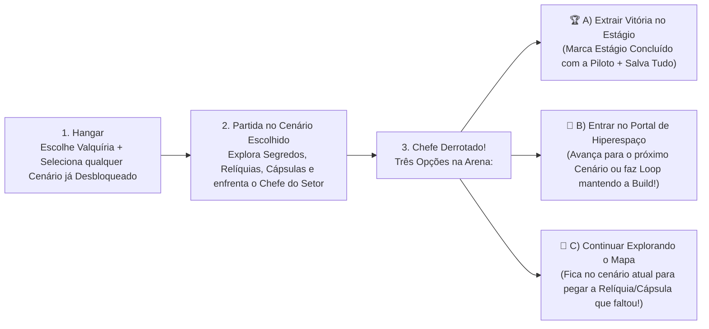

# 🗺️ GDD Fase 4 — Arquitetura de Mapas Separados, Modelo Híbrido (*Stage Select* + Portal), Segredos & Desbloqueio Condicional

Este documento consolida a evolução de **Astra Valkyries: Void Protocol** para a **Fase 4 (Sprints 25 a 28)**, unindo:
1. **Arquitetura de Mapas Separados por Bioma** (cada cenário gerado por sua própria classe com geometria, paredes, perigos e segredos exclusivos, acabando com o layout único repetido);
2. **Progressão Híbrida Reinventada** (*Stage Select* no menu com condições estilo *Vampire Survivors* + escolha ao derrotar o Chefe entre **Extrair Vitória**, **Continuar explorando o mapa sem limite** ou **Saltar pelo Portal de Hiperespaço** para o próximo setor/loop);
3. **Relíquias Permanentes, Cápsulas (Coffins) e Itens Fixos de Mapa** escondidos nas coordenadas extremas para recompensar revisitas;
4. **Arsenal Desbloqueado por Condições Reais de Gameplay**.

---

## 🏗️ 1. Por que Gerar Cada Mapa Separado? (Diagnóstico do Gerador Atual)

Hoje, o arquivo [`SectorMapGenerator`](file:///home/mateus/Projects/astra-valkyries/lib/game/map/sector_map_generator.dart) usa **uma única função monolítica** que coloca exatamente as mesmas 4 paredes metálicas, o mesmo portão laser, as mesmas 2 nebulosas e o mesmo cofre nas mesmas coordenadas em todos os 7 setores. Por isso todos os cenários parecem ter a mesma "planta baixa".

### A Nova Arquitetura Modular (`lib/game/map/biomes/`)
Cada cenário passa a ter seu próprio **Biome Map Builder** independente implementando a interface `BiomeMapArchitect`:

```mermaid
classDiagram
    class BiomeMapArchitect {
        <<interface>>
        +SectorId sectorId
        +buildBiome(AsteroidsGame game, Random rng) SectorMapData
        +spawnBiomeWallsAndChambers()
        +spawnBiomeHazardsAndPois()
        +spawnHiddenRelicAndSecret()
        +spawnFloorPickups()
    }
    BiomeMapArchitect <|-- VestaBeltMapBuilder : "Setor 1: Anéis de Asteroides & Outposts"
    BiomeMapArchitect <|-- HeliosForgeMapBuilder : "Setor 2A: Grande Corredor Industrial Solar"
    BiomeMapArchitect <|-- CryoAbyssMapBuilder : "Setor 2B: Labirinto Glacial & Domo Térmico"
    BiomeMapArchitect <|-- AegisGraveyardMapBuilder : "Setor 3A: Fortaleza de Encouraçados"
    BiomeMapArchitect <|-- XenoHiveMapBuilder : "Setor 3B: Câmaras Celulares de Biomassa Viva"
    BiomeMapArchitect <|-- EventHorizonMapBuilder : "Setor 4: Anéis Gravitacionais da Singularidade"
    BiomeMapArchitect <|-- VoidThroneMapBuilder : "Setor 5: Catedral Cósmica dos Arquitetos"
```

### Geometria e Identidade Própria de Cada Mapa:
1. **🪨 Setor 1 — Cinturão de Vesta (`VestaBeltMapBuilder`):**
   - **Geometria:** Fronteira aberta com anéis circulares de asteroides ricos em minério, postos de mineração e destroços civis.
   - **Segredos nas Bordas:** *Radar Estelar Aegis* (Norte extremo) + *Cápsula Criogênica de Vesper* (Noroeste, guardada por 3 *Aegis Bulwarks*).
2. **🔥 Setor 2A — Forja Solar de Hélio (`HeliosForgeMapBuilder`):**
   - **Geometria (Estilo *Inlaid Library*):** Um colossal **Corredor de Megaestrutura Horizontal** atravessando o mapa de Leste a Oeste, com pontes de contenção laser, fornalhas solares e dutos de magma nas paredes superior e inferior.
   - **Segredos nas Bordas:** *Tomo de Fusão Térmica* (extremo Oeste da refinaria) + *Reator Solar Adormecido* (extremo Leste).
3. **❄️ Setor 2B — Abismo Criogênico de Caelum (`CryoAbyssMapBuilder`):**
   - **Geometria:** Cânions de gelo diagonais, bancos densos de *Cryo Mist* e campos minados criogênicos cercando um **Domo Térmico Central** onde o Mercador Errante se abriga.
   - **Segredos nas Bordas:** *Sinalizador do Mercador* (Sul profundo) + *Obelisco Congelado de Caelum* (Nordeste).
4. **⚓ Setor 3A — Cemitério da Frota Aegis (`AegisGraveyardMapBuilder`):**
   - **Geometria (Estilo *Gallo Tower*):** Carcaças gigantes de Encouraçados formando salas retangulares interligadas, corredores estreitos defendidos por `DerelictTurretComponent` e campos de minas magnéticas.
   - **Segredos nas Bordas:** *Matriz de Mutações Duplas* + *Núcleo do Encouraçado Soberano*.
5. **🧬 Setor 3B — Colmeia Xeno-Biológica de Nêmesis (`XenoHiveMapBuilder`):**
   - **Geometria:** Nenhuma parede metálica! O mapa inteiro é dividido por **Paredes de Biomassa Viva Regenerativa** (`OrganicBiomassWallComponent`) em formato de favos/câmaras orgânicas repletas de `XenoCocoonComponent`.
   - **Segredos nas Bordas:** *Selo Amarelo de Nêmesis* + *Casulo Real Ancestral* (libera a matriz da Astraea).
6. **🕳️ Setor 4 (`EventHorizonMapBuilder`) & 👑 Setor 5 (`VoidThroneMapBuilder`):**
   - **Geometria:** Arenas astrais concêntricas com pilares dos Arquitetos e vórtices gravitacionais simétricos.

---

## 🔄 2. O Modelo Híbrido de Progressão (*Stage Select* + Portal Pós-Chefe)

Combinamos a liberdade e o colecionismo de **Vampire Survivors** com a adrenalina de continuar a run de **Dead Cells / Risk of Rain 2**:



### Condições de Desbloqueio dos Cenários (Estilo *Vampire Survivors*):
- **Setor 1 (Cinturão de Vesta):** Liberado desde o início.
- **Setor 2A (Forja de Hélio):** 🔒 *Alcance o Nível 8 de Piloto no Cinturão de Vesta.*
- **Setor 2B (Abismo Criogênico):** 🔒 *Derrote o Dreadnought Leviathan no Setor 1 OU chegue ao Nível 10 com a Selene.*
- **Setor 3A (Cemitério Aegis):** 🔒 *Sobreviva/Vença o Setor 2A OU recupere 2 Caixas Pretas.*
- **Setor 3B (Colmeia Xeno):** 🔒 *Sobreviva/Vença o Setor 2B OU elimine 150 Void Swarmers.*
- **Setor 4 (Horizonte de Eventos):** 🔒 *Derrote o Chefe do Setor 3A ou 3B.*
- **Setor 5 Secreto (O Trono do Vazio):** 🔒 *Jogue com 3+ Void Cells OU colete a Relíquia Selo Amarelo de Nêmesis no Setor 3B.*

---

## 🧭 3. Relíquias Permanentes, Cápsulas & Checklist por Mapa

No Hangar, ao selecionar um Cenário para jogar, o jogador vê o **Checklist de Descobertas daquele Mapa** (igual ao *Stage Select* do *Vampire Survivors*):
- `🗺️ Relíquia do Setor: [Encontrada / Pendente]`
- `⚰️ Cápsula / Evento Secreto: [Concluído / Pendente]`
- `🎖️ Concluído com: [✓] Lyra  [ ] Selene  [ ] Vesper  [ ] Astraea`

Quando o jogador encontra o **Radar Estelar Aegis** (Relíquia do Setor 1), o HUD passa a exibir uma **Bússola de Segredos (`RelicCompassHud`)** nas bordas da tela apontando a direção e a distância (`380m ↖`) para qualquer Relíquia, Cápsula ou Item Fixo ainda não coletado naquele mapa!

---

## 🔫 4. Desbloqueio Progressivo de Armas por Condições (*Feat-Gated Arsenal*)

O jogador começa apenas com as **4 Armas Base** liberadas no pool de Level-Up. As **8 Armas Avançadas** são destravadas automaticamente (com um *Toast* dourado na tela durante a partida) ao cumprir suas condições:

| Arma | Condição de Desbloqueio (*Vampire Survivors* Style) |
| :--- | :--- |
| **Aegis Sawblades** | Destruir 80 asteroides acumulados OU quebrar 5 escudos de *Aegis Bulwark*. |
| **Tesla Arc Cannon** | Alcançar Nível 3 com *Rapid Fire* OU abater 80 inimigos em uma partida. |
| **Quantum Chakram** | Executar 20 *Dashes* em uma partida OU ativar o Obelisco Congelado no Setor 2B. |
| **Repulsor Gravity Aura** | Sobreviver à Sobrecarga de uma Nebulosa OU coletar 5 cápsulas de reparo. |
| **Solar Thermal Lance** | Alcançar Nível 8 na Forja de Hélio (2A) OU aplicar *Solar Burn* 25 vezes. |
| **Inferno Plasma Cone** | Derrotar qualquer Chefe de Setor jogando com **Lyra Vancroft**. |
| **Valkyrie Wingmen** | Abrir uma Cápsula de Estase secreta OU atingir Elo de Afinidade Nível 2. |
| **Void Cluster Mines** | Destruir 10 Minas Criogênicas/Proximidade OU vencer um Chefe sem tomar dano. |
