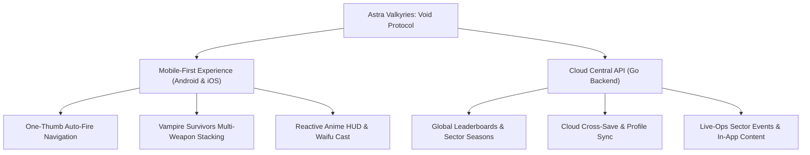

# Astra Valkyries: Void Protocol
## Strategic Target: Mobile-First Roguelite & Pacing Architecture

---

### 1. Executive Summary & Market Positioning

**Astra Valkyries: Void Protocol** is strategically aligned as a **Mobile-First Bullet-Hell Roguelite (Survivors-like)** targeting **Google Play Store (Android)** and the **Apple App Store (iOS)**, with Desktop / Web acting as promotional demo channels (e.g. Itch.io).

---

### 2. Why Mobile-First is the Superior Strategic Move

1. **One-Thumb Survivor-Like Gameplay:**
   - Auto-aim / auto-fire removes manual tapping fatigue.
   - The player navigates using a smooth virtual joystick or drag steering with one thumb.
   - Short, high-intensity runs (5 to 12 minutes) fit mobile daily commuting and breaks.

2. **Native Cross-Platform Tech Stack (Flutter + Flame):**
   - Flutter compiles to native ARM64 for both Android and iOS.
   - Instant UI responsiveness, fluid 60/120 FPS render pipeline, and responsive layouts across all phone and tablet screen ratios.

3. **Go Backend in Its True Home (Cloud Central Service):**
   - In single-player PC games on Steam, running a local HTTP daemon (`localhost:8080`) is non-standard and raises firewall warnings.
   - On Mobile, the Go server is deployed to a lightweight cloud environment (Google Cloud Run or affordable VPS) serving as a secure global API:
     - Global and weekly leaderboards
     - Player accounts & cloud save backups
     - Daily pilot missions and live-ops sector alerts

4. **Monetization Fit for the Anime / Waifu Audience:**
   - **Fair Free-to-Play:** No pay-to-win gates.
   - **Rewarded Ads:** *"Watch transmission to emergency recharge shields (1x per run)"* or *"Double Stardust extraction"*.
   - **No-Ads Convenience Pass:** Single one-time purchase removing all non-rewarded ads.
   - **Cosmetics & Pilots:** Premium pilot skins, visual effects, and Secret Memory Gallery unlocks.

---

### 3. Pacing & Progression Balance Model

#### 3.1 Weapon Fire Cadence (Humble Start ➔ Escalating Bullet-Hell)
In survivor-likes, starting with excessive fire-rate trivializes early combat and ruins progression. Weapons must start deliberate and rhythmic, making upgrades feel intensely rewarding:

| Weapon | MK 1 (Starting) | MK 2 (Upgrade) | MK 3 (Overdrive) | Tactical Role |
| :--- | :--- | :--- | :--- | :--- |
| **Pulse Blaster** | Cooldown: `0.70s` • Dmg: `60.0` | Cooldown: `0.50s` • Dmg: `75.0` | Cooldown: `0.35s` • Dmg: `100.0` (Dual parallel bolts) | Rhythmic, high-velocity kinetic strike |
| **Spread Cannon** | Cooldown: `0.95s` • Dmg: `32.0` (3-way) | Cooldown: `0.72s` • Dmg: `42.0` (3-way) | Cooldown: `0.52s` • Dmg: `55.0` (Wide 5-way fan) | Frontal crowd clearance barrier |
| **Phase Laser** | Cooldown: `0.32s` • Dmg: `20.0` | Cooldown: `0.22s` • Dmg: `26.0` | Cooldown: `0.14s` • Dmg: `34.0` (Piercing line) | Rapid-pulse photon stream |
| **Antimatter Torpedo** | Cooldown: `1.80s` • Dmg: `180.0` (Homing) | Cooldown: `1.40s` • Dmg: `240.0` (Radius 120) | Cooldown: `1.00s` • Dmg: `320.0` (Radius 150) | Heavy smart-seeking demolition |

#### 3.2 Stardust XP Drop Values & Level Curve
- **Small Asteroid Drop:** `2 Stardust` (Common fragment)
- **Medium Asteroid Drop:** `6 Stardust` (Intermediate split)
- **Large Asteroid Drop:** `14 Stardust` (Heavy rock breach)

#### 3.3 Dynamic Level Progression Curve
Formula:
$$\text{XP}(L) = 24 + (L - 1) \times 28 + (L^2 \times 6)$$

* **Level 1 ➔ 2:** **30 XP** (~35 seconds: requires destroying ~1 large asteroid family or ~15 fragments)
* **Level 2 ➔ 3:** **76 XP** (~50 seconds)
* **Level 3 ➔ 4:** **134 XP** (~65 seconds)
* **Level 4 ➔ 5:** **204 XP** (~80 seconds)
* **Level 5 ➔ 6:** **286 XP**
* **Level 6 ➔ 7:** **380 XP**
* **Level 7 ➔ 8:** **486 XP**
* **Level 8 ➔ 9:** **604 XP**
* **Level 9 ➔ 10:** **734 XP**

---

### 4. Implementation Checklist
- [x] Document Mobile-First target & Cloud Go architecture.
- [x] Calibrate weapon cadences in `lib/game/weapons.dart`.
- [x] Calibrate Stardust XP orb values in `lib/game/components/xp_orb.dart`.
- [x] Implement smooth polynomial XP curve in `lib/game/asteroids_game.dart`.
- [x] Disable legacy science-fair automatic weapon evolutions; enforce strict roguelike perks.
- [x] Expand world into a 4800x4800 procedural space sector with smooth camera follow.
- [x] Implement dynamic proximity asteroid spawning and memory culling for 60 FPS mobile performance.
- [x] Add tactical mini-radar, coordinate telemetry, and boundary hazard perimeter.
- [x] Document sector architecture in [`docs/PROCEDURAL_SECTOR_MAP.md`](file:///home/mateus/Projects/astra-valkyries/docs/PROCEDURAL_SECTOR_MAP.md).
- [x] Maintain 100% passing test suite across all subsystems (35/35 tests passing).
