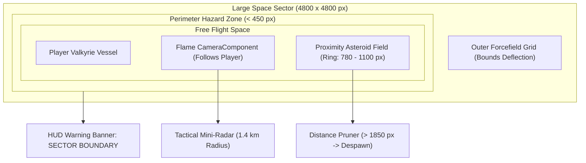

# Astra Valkyries // Procedural Sector & World Expansion

> [!NOTE]
> Documento técnico que detalha a transição do canvas fixo original (*Asteroids 1979*) para um **Setor Espacial Aberto de 4.800 × 4.800 pixels**, com Câmera Seguidora, Spawner Dinâmico de Proximidade, Barreira Perimetral de Risco e Mini-Radar Tático no HUD.

---

## 1. Visão Geral da Arquitetura

O jogo agora opera com o conceito de **Setor Espacial Aberto**. Em vez de ficar confinado a uma tela fixa de 1280×720 com teletransporte rígido nas bordas (*screen wrap*), a nave da Valquíria navega livremente em uma arena cósmica expansiva.



---

## 2. Componentes e Mecânicas Implementadas

### 2.1 Câmera Seguidora (`CameraComponent.follow`)
- **Implementação**: Em [`lib/game/asteroids_game.dart`](file:///home/mateus/Projects/astra-valkyries/lib/game/asteroids_game.dart), o `camera.viewport` mantém a resolução lógica de `1280×720` para renderização consistente em qualquer tamanho de celular, enquanto o `camera.viewfinder` persegue a posição da jogadora em tempo real:
  ```dart
  camera.viewfinder.position = player.position;
  camera.follow(player);
  ```
- **Transição de Estados**: Ao pausar ou voltar ao Hangar Bay, a câmera desacopla suavemente (`camera.stop()`), retornando o foco para o centro do setor.

---

### 2.2 Dimensões do Setor e Barreira Perimetral
- **Área Total**: `4.800 px × 4.800 px` (constantes definidas em [`lib/constants.dart`](file:///home/mateus/Projects/astra-valkyries/lib/constants.dart)).
- **Zona de Risco (< 450 px das bordas)**:
  - O [`PlayerComponent`](file:///home/mateus/Projects/astra-valkyries/lib/game/components/player.dart) detecta a aproximação dos limites e ativa `isNearBoundary = true`.
  - **Força Repulsiva Suave**: Uma aceleração vetorial contrária (`toCenter * pushFactor * 320 px/s²`) empurra a nave de volta para o centro seguro do setor.
  - **Alerta no HUD**: Um banner vermelho pulsante surge na tela: `WARNING: SECTOR BOUNDARY // HAZARD PERIMETER`.
  - **Barreira Rígida**: Caso atinja a borda extrema, a nave é contida elasticamente e sua velocidade é defletida (`velocity *= -0.45`).
- **Renderização Visual**: A classe [`SectorBoundaryComponent`](file:///home/mateus/Projects/astra-valkyries/lib/game/components/sector_boundary.dart) desenha a malha holográfica de coordenadas a cada 400 px e o campo de força vermelho pulsante nas quatro bordas do setor.

---

### 2.3 Spawner Dinâmico de Proximidade (Garantia de 60 FPS Mobile)
Para manter o jogo leve e sem travamentos em celulares com processadores intermediários:
1. **Raio de Spawn em Anel**: Asteroides surgem exclusivamente em uma coroa circular entre `780 px` e `1.100 px` de distância da nave (logo além do alcance visível da câmera).
2. **Vetor de Interceptação**: A trajetória dos meteoros gerados é calculada apontando para a vizinhança da nave com variação angular aleatória ($\pm 45^\circ$).
3. **Culling / Reciclagem**: Qualquer asteroide que se afaste mais de `1.850 px` da jogadora é automaticamente removido pelo método `shouldPrune()` em [`AsteroidComponent`](file:///home/mateus/Projects/astra-valkyries/lib/game/components/asteroid.dart).
4. **Teto de Atividade**: O número de asteroides ativos na memória permanece estritamente limitado a **38 instâncias**, preservando a taxa de 60 FPS com baixo consumo de bateria.

---

### 2.4 Mini-Radar Tático no HUD
Em [`lib/ui/hud_overlay.dart`](file:///home/mateus/Projects/astra-valkyries/lib/ui/hud_overlay.dart), um radar circular de tecnologia militar foi integrado no canto superior direito:
- **Alcance Operacional**: Escala de `1.400 metros` (1.400 px ao redor do caça).
- **Varredura Animada**: Feixe de radar rotativo sincronizado a `60 FPS` via `Ticker`.
- **Pontos de Contato (Blips)**:
  - *Pontos Ciano/Prata*: Asteroides próximos.
  - *Ponto Dourado Pulsante*: Cometa Halley ou eventos cósmicos de elite.
  - *Seta Central*: Direção e orientação exatas do caça da jogadora.
- **Telemetria de Coordenadas**: Exibe o quadrante espacial em tempo real (`SEC [X:24, Y:24]`).

---

### 2.5 Parallax Estelar e Nebulosas
O [`StarfieldComponent`](file:///home/mateus/Projects/astra-valkyries/lib/game/components/starfield.dart) foi adaptado para ancorar seu desenho sempre nas coordenadas do viewport da câmera (`camPos.x - width / 2`), movimentando três camadas de estrelas com velocidades proporcionais à velocidade do caça. O resultado é uma sensação contínua de imensidão cósmica sem costuras visíveis.

---

## 3. Próximos Passos de Expansão Procedural

1. **Pontos de Interesse (POIs) Estáticos**:
   - Estações de Transmissão Desativadas no quadrante noroeste que liberam baús de Stardust ao serem defendidas.
   - Campos de Matéria Escura que reduzem a velocidade da nave mas aumentam o dano crítico em 50%.
2. **Sondas de Patrulha / Inimigos de Elite**:
   - Drones autônomos que patrulham perímetros e perseguem o jogador quando detectados pelo radar.
