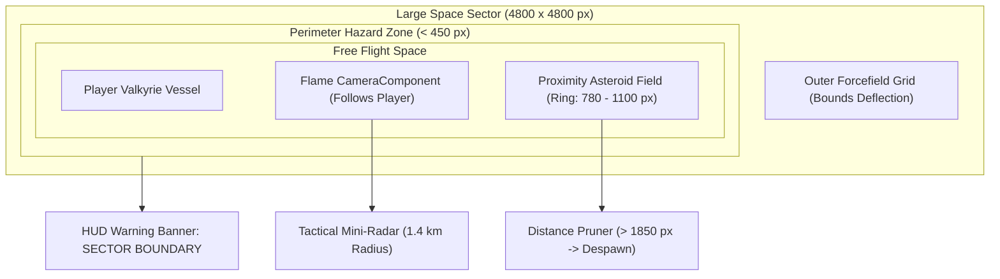

# Astra Valkyries // Procedural Sector & World Expansion

> [!NOTE]
> Documento técnico que detalha a transição do canvas fixo original (*Asteroids 1979*) para um **Setor Espacial Aberto de 4.800 × 4.800 pixels**, com Câmera Seguidora, Spawner Dinâmico de Proximidade, Barreira Perimetral de Risco e Mini-Radar Tático no HUD.

---

## 1. Visão Geral da Arquitetura

O jogo agora opera com o conceito de **Setor Espacial Aberto**. Em vez de ficar confinado a uma tela fixa de 1280×720 com teletransporte rígido nas bordas (*screen wrap*), a nave da Valquíria navega livremente em uma arena cósmica expansiva.



---

## 2. Componentes e Mecânicas Implementadas

### 2.1 Câmera Seguidora (`CameraComponent.follow`)
- **Implementação**: Em [`lib/game/asteroids_game.dart`](file:///home/mateus/Projects/astra-valkyries/lib/game/asteroids_game.dart), o `camera.viewport` mantém a resolução lógica de `1280×720` para renderização consistente em qualquer tamanho de celular, enquanto o `camera.viewfinder` persegue a posição da jogadora em tempo real:
  ```dart
  camera.viewfinder.position = player.position;
  camera.follow(player);
  ```
- **Transição de Estados**: Ao pausar ou voltar ao Hangar Bay, a câmera desacopla suavemente (`camera.stop()`), retornando o foco para o centro do setor.

---

### 2.2 Dimensões do Setor e Barreira Perimetral
- **Área Total**: `4.800 px × 4.800 px` (constantes definidas em [`lib/constants.dart`](file:///home/mateus/Projects/astra-valkyries/lib/constants.dart)).
- **Zona de Risco (< 450 px das bordas)**:
  - O [`PlayerComponent`](file:///home/mateus/Projects/astra-valkyries/lib/game/components/player.dart) detecta a aproximação dos limites e ativa `isNearBoundary = true`.
  - **Força Repulsiva Suave**: Uma aceleração vetorial contrária (`toCenter * pushFactor * 320 px/s²`) empurra a nave de volta para o centro seguro do setor.
  - **Alerta no HUD**: Um banner vermelho pulsante surge na tela: `WARNING: SECTOR BOUNDARY // HAZARD PERIMETER`.
  - **Barreira Rígida**: Caso atinja a borda extrema, a nave é contida elasticamente e sua velocidade é defletida (`velocity *= -0.45`).
- **Renderização Visual**: A classe [`SectorBoundaryComponent`](file:///home/mateus/Projects/astra-valkyries/lib/game/components/sector_boundary.dart) desenha a malha holográfica de coordenadas a cada 400 px e o campo de força vermelho pulsante nas quatro bordas do setor.

---

### 2.3 Spawner Dinâmico de Proximidade (Garantia de 60 FPS Mobile)
Para manter o jogo leve e sem travamentos em celulares com processadores intermediários:
1. **Raio de Spawn em Anel**: Asteroides surgem exclusivamente em uma coroa circular entre `780 px` e `1.100 px` de distância da nave (logo além do alcance visível da câmera).
2. **Vetor de Interceptação**: A trajetória dos meteoros gerados é calculada apontando para a vizinhança da nave com variação angular aleatória ($\pm 45^\circ$).
3. **Culling / Reciclagem**: Qualquer asteroide que se afaste mais de `1.850 px` da jogadora é automaticamente removido pelo método `shouldPrune()` em [`AsteroidComponent`](file:///home/mateus/Projects/astra-valkyries/lib/game/components/asteroid.dart).
4. **Teto de Atividade**: O número de asteroides ativos na memória permanece estritamente limitado a **38 instâncias**, preservando a taxa de 60 FPS com baixo consumo de bateria.

---

### 2.4 Mini-Radar Tático & Navegação Espacial no HUD
Em [`lib/ui/hud_overlay.dart`](file:///home/mateus/Projects/astra-valkyries/lib/ui/hud_overlay.dart), um radar circular de tecnologia militar foi integrado no canto superior direito:
- **Alcance Operacional**: Escala de `1.400 metros` (1.400 px ao redor do caça).
- **Varredura Animada**: Feixe de radar rotativo sincronizado a `60 FPS` via `Ticker`.
- **Pontos de Contato (Blips)**:
  - *Pontos Ciano*: Asteroides nas proximidades.
  - *Quadrados Âmbar/Dourados*: Containers de Carga Derelict ([`CargoWreckComponent`](file:///home/mateus/Projects/astra-valkyries/lib/game/components/cargo_wreck.dart)).
  - *Losango Dourado com Pulso de Baliza*: Estação Científica de Transmissão ([`SpaceStationComponent`](file:///home/mateus/Projects/astra-valkyries/lib/game/components/space_station.dart)).
  - *Seta Indicadora de Borda (Waypoint)*: Quando a Estação de Pesquisa estiver fora do alcance do radar (> 1.400 px), uma seta dourada na borda do radar aponta ininterruptamente sua direção vetorial.
  - *Círculos Translúcidos Coloridos*: Zonas de Nebulosas Cósmicas Ionizadas (Magenta) e Matéria Escura (Ciano/Índigo).
  - *Ponto Dourado Pulsante*: Cometa Halley ou eventos cósmicos de elite.
  - *Seta Central*: Direção e orientação exatas do caça da jogadora.
- **Telemetria de Coordenadas**: Exibe o quadrante espacial em tempo real (`SEC [X:24, Y:24]`).

---

### 2.5 Elementos de Cenário e Pontos de Interesse (POIs)

Para que o vácuo espacial não seja monótono e encoraje exploração tática roguelike, o setor agora conta com 3 classes de entidades vetoriais procedurais:

1. **Estação Espacial / Relay de Pesquisa Abandonado ([`SpaceStationComponent`](file:///home/mateus/Projects/astra-valkyries/lib/game/components/space_station.dart))**:
   - **Localização**: Quadrante Noroeste `(1500, 1500)`.
   - **Mecânica de Transmissão**: Ao entrar no perímetro de transmissão (240 px), inicia-se o uplink de dados durante 15 segundos. Se a nave sair da área, o progresso decai lentamente.
   - **Recompensa**: Ao completar o upload (100%), a estação é marcada como `isSecured`, recompensa +1500 pontos, ativa escudo restaurador e ejeta 5 Orbes Grandes de Stardust XP.
   - **HUD**: Barra de progresso de upload em tempo real no topo da tela.

2. **Containers de Carga Espacial Derelict ([`CargoWreckComponent`](file:///home/mateus/Projects/astra-valkyries/lib/game/components/cargo_wreck.dart))**:
   - **Localizações**: `(3400, 1300)` e `(1300, 3500)`.
   - **Resistência & Dano**: Blindagem reforçada com 180 HP, flash de impacto e números de dano flutuantes. Destrutível por tiros normais ou explosões de bombas/mísseis.
   - **Loot de Ruptura**: Ao quebrar, concede +450 pontos e libera 3 Orbes de Stardust Médias + 1 Drop Raro garantido (Escudo Fotônico, Nanites de Reparo ou Hélio-3 Raro).

3. **Nebulosas Cósmicas com Modificadores de Combate ([`CosmicNebulaComponent`](file:///home/mateus/Projects/astra-valkyries/lib/game/components/cosmic_nebula.dart))**:
   - **Nuvem de Íons (`NebulaType.ionCloud`) em `(3400, 3300)`**:
     - *Bônus*: +30% na cadência de disparos (recharge acelerado em 0.7x).
     - *Risco*: Escudos desativados enquanto permanecer na nuvem (dano imediato ao tocar em meteoros).
   - **Bolsão de Matéria Escura (`NebulaType.darkMatter`) em `(1400, 3200)`**:
     - *Bônus*: +50% de taxa de acerto crítico (dano dobrado).
     - *Risco*: Gravidade densa que reduz a velocidade máxima em 30%.
   - **HUD**: Badge luminoso e estilizado identifica a nebulosa atual e os bônus ativos.

---

### 2.6 Parallax Estelar e Otimização 100% Vetorial
O jogo utiliza **100% de computação gráfica vetorial procedural** (`Canvas` nativo Flutter/Flame). Não depende de pacotes de sprites externos para entidades de jogo, garantindo:
- **Tamanho Mínimo de Download**: APK leve (< 25 MB).
- **Escala de Resolução Infinita**: Não borra nem perde nitidez em telas 4K, tablets ou monitores ultrawide.
- **Liberação Comercial Total**: Licenças permissivas (MIT / BSD-3 / OFL), zero risco de copyright de terceiros.

---

## 3. Próximos Passos de Expansão
1. **Sondas Autônomas e Drones Hostis**:
   - Patrulhas robóticas que guardam os arredores dos containers de carga.
2. **Eventos Climáticos Espaciais**:
   - Tempestades solares repentinas e anomalias de fenda quântica com portais de transporte rápido.
