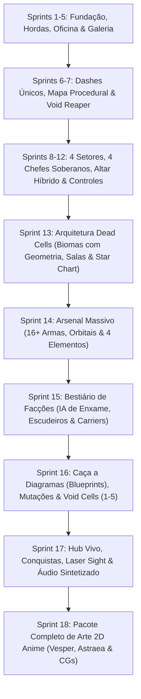

# 🚀 Astra Valkyries: Void Protocol
## Agile Roadmap & Sprint Execution Plan

**Projeto:** *Astra Valkyries: Void Protocol*  
**Versão Atual:** Beta 1.0.0 (Sprints 1–12 Concluídas) → Planejamento Expansão Roguelite 2.0 (Sprints 13–18)  
**Stack:** Flutter + Flame (Engine 2D Vetorial) & Go Backend (Central Cloud API)  
**Data:** 07/11/2026  

---

### Visão Geral do Ciclo de Produção

---

## 🏁 SPRINT 1: Fundação Mobile-First, Setor 4.8k & Pilotos
- **Status:** ✅ **CONCLUÍDA** (Commits `52deeef`, `b262d82`)
- **Objetivo:** Estabelecer a física inercial de voo, o mapa procedural expansivo e a adaptação ergonômica de toque para smartphones.

### Entregáveis:
- [x] Setor procedural aberto de 4800x4800 com bordas de contenção de plasma.
- [x] Câmera dinâmica com rastreamento suave da nave da jogadora.
- [x] Mini-radar tático vetorial com cálculo de alcance e ângulo de varredura.
- [x] POIs Procedurais: Estação de Pesquisa, Destroços de Carga e Nebulosas Cósmicas.
- [x] HUD Mobile Ergonomic Cluster: Thumb-stick virtual, botão de Dash circular com cooldown, Especial Overdrive e Disparo Manual.
- [x] O Trio Inicial de Valquírias (Lyra, Selene e Vesper) com specs, design de nave e armas iniciais distintas.
- [x] Mini-avatar reativo na HUD com 3 estados (Normal, Crítico e Overdrive).
- [x] Resolução do bug de renderização de overlays no Flutter (`StackParentData`).

---

## 👾 SPRINT 2: Fórmula Vampire Survivors, Frotas & Baús
- **Status:** ✅ **CONCLUÍDA** (Commits `73f0eae`, `ba36fb6`)
- **Objetivo:** Eliminar a monotonia de combate apenas contra meteoros, inserindo IA hostil ativa, minibosses cronometrados e recompensas em baús.

### Entregáveis:
- [x] **Scout Drone:** Nave de enxame (1 a 2 tiros) com perseguição direta e fluxo constante de Stardust XP.
- [x] **Phantom Raider:** Caça veloz com máquina de estados (`stalking` $\to$ `telegraphing` com laser vermelho $\to$ `charging` a 390 px/s com Dash evasivo).
- [x] **Corvette Sniper:** Artilharia de média distância que atira orbes lentos de plasma.
- [x] **Variantes de Asteroides:** Prisma Cristalino (não divide, explode em chuva de 8 orbes de XP) e Asteroide de Magma (poça térmica persistente de dano em área).
- [x] **Void Commander (Elite Miniboss):** Flagship imponente com barra de vida flutuante, tiros em espiral e drop garantido de baú.
- [x] **Baú Cósmico & Jackpot Overlay:** Recompensa de 1x, 3x ou 5x cartas estilo caça-níquel/Vampire Survivors, concedendo as melhorias sorteadas de arsenal e atributos.
- [x] **Red Gem Siphon (Otimização Mobile):** Teto rígido de 60 orbes de XP em tela, concentrando excedente no orbe mais distante como Hiper-Stardust Vermelho para manter 60 FPS cravados.
- [x] **53 Testes Automatizados** cobrindo todas as mecânicas.

---

## ⚡ SPRINT 3: Super-Evoluções de Armas & Chefe Final de Setor
- **Status:** ✅ **CONCLUÍDA** (Commit `c5a925d`)
- **Objetivo:** Implementar o auge da catarse do combate (armas evoluídas devastadoras) e o clímax da partida (batalha em fases contra o Dreadnought Leviathan).

### Entregáveis:
1. **As 4 Super-Evoluções de Arsenal (Evoluídas via Baú Cósmico no Nível Máximo):**
   - [x] **Supernova Annihilator** (Evolução do *Pulse Blaster*): Feixe duplo acelerado de plasma ultra-denso com micro-detonações em cadeia ao atravessar inimigos (`piercesLeft = 99`, 150 dmg, 0.16s cooldown).
   - [x] **Hyperion Flak Storm** (Evolução do *Spread Cannon*): Barreira circular 360° contínua de fragmentos de flak em 10 direções, desintegrando projéteis e enxames (75 dmg/fragmento, 0.38s cooldown).
   - [x] **Absolute Zero Tachyon Beam** (Evolução do *Phase Laser*): Raio contínuo perfurante criogênico em altíssima cadência (50 dmg, 0.075s cooldown).
   - [x] **Singularity Rift Torpedo** (Evolução do *Antimatter Torpedo*): Torpedo teleguiado de 420 dmg que, ao detonar, invoca um vórtex negro (`SingularityRiftComponent`) com atração gravitacional e colapso estelar.
2. **Chefe Final de Setor: Dreadnought Leviathan:**
   - [x] Spawna com 3.500 HP, raio 72px e telemetria de barra de vida de setor no topo da HUD.
   - [x] **Fase 1 (Escolta & Baterias):** Casco blindado com disparo alternado de torretas duplas de plasma.
   - [x] **Fase 2 (Núcleo Exposto & Danmaku):** Espirais rotativas de 12 projéteis densos em 360°.
   - [x] **Fase 3 (Colapso Hiperbólico):** Disparo telegrafado de feixe de Railgun pesado e invocação de drones de escolta.
3. **Condição de Vitória da Sortie & Jackpots:**
   - [x] Ao destruir o Leviathan, dropa Baú Cósmico Lendário de 5 cartas de Jackpot + 5 gemas gigantes de Stardust, acionando a vitória do setor.
   - [x] 62 testes unitários e de integração passando 100%.

---

## 🛠️ SPRINT 4: Meta-Progressão, Oficina do Hangar & Economia
- **Status:** ✅ **CONCLUÍDA**
- **Objetivo:** Fechar o loop roguelite duradouro, permitindo que cada derrota ou vitória fortaleça a jogadora para as próximas missões.

### Entregáveis:
1. **Oficina das Valquírias (Hangar Workshop & Meta-Progression):**
   - [x] Árvore de Meta-Upgrades permanentes comprados com Sucata Cósmica (*Credits*):
     - *Hull Reinforcement* (Vida inicial +1 a +3);
     - *Ion Magnet Overdrive* (Raio de coleta +20% a +100%);
     - *Hyper-Thrusters* (Velocidade +8% a +40% e redução do Cooldown de Dash);
     - *Quantum Targeting* (Taxa de Crítico +4% a +20% e Dano Geral +6% a +30%);
     - *Lucky Star Protocol* (Chance de Baús 3x e 5x +10% a +40%).
   - [x] Botão de Reembolso Total a 100% (*Refund All*) sem penalidade.
2. **Economia de Sucata Cósmica (Scrap Flow):**
   - [x] Asteroides, frotas inimigas (Scout, Raider, Sniper, Elite) e POIs dropam créditos em tempo real.
   - [x] Bônus de sobrevivência de missão (+350c) e abate do Leviathan (+500c).
   - [x] Telemetria de sucata adicionada à HUD in-game e à tela de Game Over.
3. **Revisão Mobile & Menu Unificado:**
   - [x] Hangar unificado em `ValkyrieSelectionOverlay` com seletor de abas (`SORTIE` vs `OFICINA`).
   - [x] Compatibilidade ergonômica com toque e atalhos de teclado (Tab, Q/E, A/D, Setas, Enter).
4. **Testes Automatizados:**
   - [x] 70 testes automatizados cobrindo progressão, economia e componentes de UI.

---

## 🛡️ PATCH 0.5.5 / SPRINT 4.5: Sistema de Casco (HP Bar), Reparos Nanotecnológicos & HUD Responsiva Universal
- **Status:** ✅ **CONCLUÍDA**
- **Objetivo:** Substituir as 3 vidas discretas por uma barra contínua de Integridade do Casco (Hull HP), calibrar danos e imunidade sem interrupção de fluxo, adicionar drops de cura aleatórios com mecânica de piedade e blindar a HUD contra quebras em qualquer resolução de tela (mobile e desktop).

### Entregáveis:
1. **Barra de Integridade de Casco (Hull HP Continuous Gauge):**
   - [x] Substituição dos 3 corações discretos por medidor cibernético proporcional (`hp / maxHp`).
   - [x] HP base escalonado por arquétipo de Valquíria (Lyra: 100 HP, Selene: 120 HP blindada, Vesper: 90 HP ágil) + bônus de Meta-Progresso (+25 HP por nível de *Hull Reinforcement*).
   - [x] Danos por colisão calibrados: Asteroides Pequenos (14 HP), Médios (24 HP), Grandes (35 HP); Frotas Inimigas (16 a 45 HP); Projéteis de Plasma (18 a 22 HP).
   - [x] Janela de invulnerabilidade com i-frames (0.85s) e screen shake, sem teleportar a jogadora para o centro da tela em danos não-letais.
2. **Cápsulas de Reparo Nanotecnológico (Health Drops) & Mecânica de Piedade (Pity):**
   - [x] `DropType.health` restaura de +25 a +45 HP com efeito sonoro e texto flutuante verde esmeralda `+XX HP REPARO! 💚`.
   - [x] Taxa de drop base em asteroides (7%) e inimigos (8%), dobrando com *Pity Rate* (15% e 16%) quando a integridade da jogadora está abaixo de 50%. Drop garantido de 100% ao abater Elites.
3. **Correção Definitiva da HUD Multi-Resolução:**
   - [x] Eliminação de todos os estouros de `RenderFlex` em resoluções ultra-widescreen, desktop padrão e smartphones compactos (667x375, 844x390, 1920x1080).
   - [x] Medidores de HP, XP e Chefe Leviathan com larguras responsivas auto-ajustáveis e textos com truncamento inteligente (`TextOverflow.ellipsis`).
4. **Bateria de Testes:**
   - [x] 84 testes automatizados cobrindo dano contínuo, mecânica de cura, pity drops e validação em 8 resoluções distintas.

---

## 💖 SPRINT 5: Galeria de Waifus, Afinidade & Micro-Balanceamento Beta
- **Status:** 🚀 **EM ANDAMENTO / PARCIALMENTE CONCLUÍDA**
- **Objetivo:** O motor de engajamento do público de anime, polimento de som/vozes e calibração fina de parâmetros para o lançamento comercial.

### Entregáveis:
1. **Sistema de Afinidade (Bond System & Dialogues):**
   - [x] Níveis de Elo (1 a 5) individuais para Lyra, Selene e Vesper com títulos progressivos (*Recruta* $\to$ *Votos Eternos*).
   - [x] Drop de *Núcleos de Memória* (`DropType.memoryCore`) em Elites e Chefes Leviathan concedendo +15 a +150 XP de Elo.
   - [x] Diálogos interativos e reativos no Hangar que mudam de tom conforme o nível de intimidade com a piloto sobe.
   - [x] Bônus passivos de combate por Elo (+2% a +8% de Crítico e Velocidade).
2. **Galeria de Memórias Secretas (CGs / Pinups):**
   - [x] Terceira aba unificada no Hangar: `GALERIA // MEMÓRIAS`.
   - [x] Catálogo de 9 ilustrações secretas desbloqueadas nos níveis 1, 3 e 5 de Elo.
   - [x] Lightbox de tela cheia com `InteractiveViewer` (zoom e pan), modo Papel de Parede limpo e dossiê narrativo.
3. **Micro-Balanceamento da Beta & Produção de Assets Finais:**
   - [ ] Integração das artes finais de alta resolução das memórias de Selene e Vesper.
   - [ ] Ajuste fino do DPS de cada arma para garantir paridade estratégica.
   - [ ] Calibração da curva de dificuldade dos 10 minutos para curva de tensão perfeita.
4. **Bateria de Testes:**
   - [x] 94 testes automatizados passando com 100% de sucesso.

---

## 🌌 SPRINTS 6 A 12: Expansão Masterpiece 1.0 (Setores 1–4, Altar Híbrido, Grimório & Controles)
- **Status:** ✅ **CONCLUÍDA** (Commit `4ef5714`)
- **Objetivo:** Fechar o ciclo de 4 Setores da campanha inicial, implementar o sistema híbrido de invocação de Chefes (*Vampire Survivors* + *Risk of Rain*), o Grimório de Superarmas, a tela de Bootloader/Menu Principal e o controle híbrido PC/Mobile.

### Entregáveis Concluídos (Sprints 6–12):
- [x] **Dashes Exclusivos por Valquíria & Segredo Konami (Astraea):** *Afterburner Surge* (Lyra), *Quantum Phase Blink* (Selene), *Phantom Quick-Slip 2x* (Vesper) e *Genesis Phase Glide* (Astraea).
- [x] **4 Setores & 4 Chefes Soberanos Multi-Fases:**
  - Setor 1 (*Cinturão de Érebo*): **Dreadnought Leviathan**.
  - Setor 2 (*Forja de Hélio*): **Ignis Core Wyrm** (serpente solar segmentada).
  - Setor 3 (*Cemitério da Frota Aegis*): **Scrap Goliath** + Minas de Proximidade e Torres Automáticas.
  - Setor 4 (*Horizonte de Eventos*): **Void Singularity Core** + Vitória da Campanha.
- [x] **Sistema Híbrido de Chefes (*Vampire Survivors* + *Risk of Rain*):** Sub-chefes automáticos por tempo (01:00 e 02:00) + Altar do Teletransportador que exige carregar **2 Sinalizadores de Anomalia** para despertar o Chefe Soberano.
- [x] **Grimório Cósmico, Modo Hiper & Boss Rush:** Receitas de evolução no menu de pausa, Modo Hiper (+25% Velocidade / +50% XP e Sucata) e Coliseu de Titãs.
- [x] **Menu Inicial com Bootloader, Loja Direta & Controle Híbrido (`WASD` Ré Tática + Mobile 360° com `LOCK/FIRE`):** 127 testes automatizados passando 100%.

---

# 🔥 FASE 2: EXPANSÃO ACTION-ROGUELITE AA (ESCALA *DEAD CELLS* / *VAMPIRE SURVIVORS* / *HADES*)

> **Diagnóstico de Game Design:** As Sprints 1 a 12 construíram um excelente *Vertical Slice*, mas a estrutura espacial de cada setor ainda funciona como uma arena aberta única. As **Sprints 13 a 18** transformam o jogo em um **Action-Roguelite profundo de dezenas de horas**, com geometria de biomas, rotas ramificadas, dezenas de armas/sinergias, facções inimigas reais e metaprogressão de Diagramas (*Blueprints*).

---

## 🗺️ SPRINT 13: Arquitetura de Biomas estilo *Dead Cells* & Mapa Estelar de Rotas (*Star Chart*)
- **Status:** ✅ **CONCLUÍDA**
- **Objetivo:** Acabar com a sensação de "arena quadrada única" transformando cada setor em um **bioma espacial estruturado com geometria, corredores, salas trancadas e escolhas de rota**.

### Entregáveis Concluídos:
1. **Geometria Espacial & Megaestruturas Internas:**
   - [x] Paredes físicas de destroços colossais (`MegastructureWallComponent`), vigas de estações orbitais e **Portões de Contenção Laser** (`LaserContainmentGateComponent`) que dividem o setor em **Zonas/Câmaras conectadas** (Zona de Entrada, Corredores de Horda, Câmara de Elite, Sala do Tesouro, Loja do Mercador e Arena do Altar).
2. **Salas de Evento & Portas de Desafio (*Dead Cells Doors*):**
   - [x] **Porta Cronometrada (*Timed Vault*):** Abre apenas se a jogadora alcançar o final do setor abaixo do tempo-alvo (< 2m00s), contendo Diagramas e Sucata massiva.
   - [x] **Porta Intocável (*Flawless Vault*):** Abre ao derrotar o Chefe do setor sem perder integridade de casco.
   - [x] **Santuários de Risco (*Cursed Chests / Void Shrines*):** Aceitar uma maldição/sacrifício de 25% de HP em troca de poder lendário.
   - [x] **Mercador Errante (*Void Merchant*):** NPC encontrado dentro da fase para comprar reparos e melhorias com a sucata da própria run.
3. **Mapa Estelar de Rotas Ramificadas (*Branching Star Chart*):**
   - [x] Ao entrar no Portal de Hiperespaço, abre o **Mapa Estelar Interativo** (`StarChartOverlay`) permitindo escolher entre rotas alternativas (*Setor 2A: Forja de Hélio* vs *Setor 2B: Abismo Criogênico*; *Setor 3A: Cemitério Aegis* vs *Setor 3B: Colmeia Xeno*).

---

## ⚔️ SPRINT 14: Arsenal Massivo (12+ Armas, Drones Orbitais & 4 Elementos com Sinergias)
- **Status:** ✅ **CONCLUÍDA**
- **Objetivo:** Multiplicar a variedade de *builds* para que nenhuma partida seja igual à outra, adicionando armas com comportamentos físicos distintos e reações elementais.

### Entregáveis Concluídos:
1. **Novas Categorias de Armas (12 Armas Jogáveis + 12 Super-Evoluções):**
   - [x] **Orbitais (*Aegis Sawblades* — estilo *King Bible*):** Lâminas de energia que orbitam a nave continuamente, bloqueando projéteis e triturando inimigos que se aproximam.
   - [x] **Corrente Elétrica (*Tesla Arc Cannon*):** Disparo que salta instantaneamente entre inimigos próximos.
   - [x] **Bumerangue Espacial (*Quantum Chakram* — estilo *Cross*):** Disco energético que atravessa a tela para frente e depois retorna com força ampliada para a nave.
   - [x] **Aura Gravitacional (*Repulsor Gravity Aura* — estilo *Garlic*):** Pulso circular ao redor da nave que causa dano contínuo a enxames e empurra inimigos leves.
   - [x] **Feixe Orbital Térmico (*Solar Thermal Lance*):** Laser contínuo de precisão que derrete armaduras.
   - [x] **Lança-Chamas de Plasma (*Inferno Plasma Cone*):** Cone curto de fogo solar que aplica queimadura acumulativa.
   - [x] **Drones Caçadores Autônomos (*Valkyrie Wingmen*):** Mini-drones que orbitam a nave caçando alvos prioritários.
   - [x] **Minas de Singularidade (*Void Cluster Mines*):** Deixadas na traseira da nave durante o *Kiting* (perfeitas para jogar dando ré!).
2. **Os 4 Status Elementais & Sinergias de Build (*Dead Cells* / *Hades*):**
   - [x] **🔥 Queimadura (*Solar Burn*):** Dano por segundo acumulativo.
   - [x] **❄️ Congelamento (*Cryo Freeze*):** Reduz velocidade de movimento/ataque inimigo em 50%.
   - [x] **⚡ Eletrificação (*Ion Shock*):** Faz ataques causarem arcos elétricos em inimigos vizinhos.
   - [x] **🟣 Corrosão do Vazio (*Void Rupture*):** Inimigos recebem +35% de dano de todas as fontes.
   - [x] **Reações de Sinergia Cruzada:** Combinar 2 elementos diferentes no mesmo alvo dispara explosão de Sinergia Elemental.

---

## 👾 SPRINT 15: Bestiário de Facções por Bioma (IA Tática & Asteroides como Terreno)
- **Status:** ✅ **CONCLUÍDA**
- **Objetivo:** Transformar asteroides em obstáculos/minérios de cenário e preencher os setores com **facções inimigas reais** que exigem posicionamento, *Kiting* e *Dash*.

### Entregáveis Concluídos:
1. **Reclassificação dos Asteroides:**
   - [x] Asteroides formam Cinturões de Cobertura Física e Veios de Minério Rico.
2. **Novos Arquétipos de Inimigos por Facção:**
   - [x] **Void Swarmers (Enxame Kamikaze):** Nascem em bandos rápidos que perseguem a nave em formação, exigindo armas de área/orbitais e *Kiting* na ré.
   - [x] **Aegis Bulwark (Escudeiro Frontal):** Nave pesada com escudo direcional frontal que bloqueia 80% do dano pela frente — obriga a jogadora a usar o *Dash* para flanquear pelas costas.
   - [x] **Carrier Hive (Nave-Mãe Invocadora):** Permanece à distância fabricando esquadrões de drones até ser eliminada.
   - [x] **Gravity Weaver (Tecelão do Vazio):** Cria zonas gravitacionais e dispara feixes de antimatéria.
   - [x] **Cryo Bomber:** Dispara projéteis criogênicos pesados que desaceleram o espaço ao redor.

---

## 🧬 SPRINT 16: Caça a Diagramas (*Blueprints*), Mutações & *Void Cells* (Dificuldade 1 a 5)
- **Status:** ✅ **CONCLUÍDA**
- **Objetivo:** Implementar a metaprogressão viciante de *Dead Cells*, onde você joga para encontrar e desbloquear novos equipamentos, mutações e níveis de dificuldade.

### Entregáveis Concluídos:
1. **Sistema de Diagramas Tecnológicos (*Blueprint Extraction*):**
   - [x] Elites, Sub-Chefes, Salas de Tempo e Chefes Soberanos dropam **Diagramas de Armas** (`tryDropBlueprint`).
   - [x] Aba **Forja de Diagramas** na Oficina para investir Sucata e liberar armas permanentemente no pool (`forgeBlueprint`).
2. **Sistema de Mutações de Piloto (Entre Setores):**
   - [x] Na transição de Hiperespaço (`StarChartOverlay`), a jogadora escolhe **1 de 3 Mutações Táticas** (máximo de 3 por run): *Adrenalina Vampírica*, *Contramedida Espelhada*, *Protocolo Lobo Solitário*, *Alquimista de Sucata*, *Sobrecarga Elemental* e *Protocolo de Emergência*.
3. **Células do Vazio (*Void Cells 0 a 5* — *Boss Stem Cells*):**
   - [x] Seletor `VOID CELLS: 0..5` no Hangar que multiplica as recompensas de Sucata (+25% por célula) e intensifica as frotas inimigas.

---

## 🎯 SPRINT 17: Mira Laser (*Tactical Sight*), Conquistas (*Milestones*), Persistência Total & Áudio
- **Status:** ✅ **CONCLUÍDA**
- **Objetivo:** Refinar o *Game Feel* de combate (especialmente no *Kiting* de ré), adicionar metas claras de desbloqueio e paisagem sonora completa.

### Entregáveis Concluídos:
- [x] **Feixe de Mira Laser (*Tactical Laser Sight*):** Implementado e posteriormente removido para garantir pilotagem limpa e natural conforme feedback de gameplay.
- [x] **Códice de Conquistas (*Milestones*):** Aba dedicada na Oficina com recompensas reais em Sucata Cósmica.
- [x] **Síntese de SFX Dedicados (`.wav`):** `level_up.wav`, `chest_open.wav`, `beacon_charge.wav` e `boss_spawn.wav` gerados e integrados.
- [x] **Persistência Completa (`SharedPreferences`):** Salva créditos, *Void Cells*, Diagramas encontrados/forjados, Conquistas e preferências de controle/física.

---

## 🎨 SPRINT 18: Pacote Completo de Arte 2D Anime & Polimento Narrativo
- **Status:** ✅ **CONCLUÍDA**
- **Objetivo:** Completar 100% dos assets visuais de personagens e ilustrações da Galeria sem nenhum *fallback*.

### Entregáveis Concluídos:
- [x] **Assets Completos da Vesper & Astraea:** `hangar_fullbody.png`, `hud_neutral.png`, `hud_damaged.png`, `hud_ultimate.png` gerados no estilo canônico anime sci-fi (mantendo Lyra e Selene intactas).
- [x] **Ilustrações da Galeria de Afinidade:** `pinup_memory_1.jpg` e `pinup_memory_2.jpg` completas para Lyra, Selene e Vesper.
- [x] **Eventos de Diálogo Pós-Run (Estilo *Hades*):** Diálogos reativos no Hangar (`getReactivePostRunDialogue`) que comentam nominalmente sobre o último Chefe enfrentado ou derrotado.

---

# 👑 FASE 3: FÍSICA UNIFICADA, BALANCEAMENTO DE HORDAS, LORE & FINAIS MÚLTIPLOS (SPRINTS 19 a 24)

> **Diretriz de Design:** Elevar a tensão, a coerência do mundo físico e a profundidade narrativa do jogo para os padrões de *Nova Drift*, *Dead Cells*, *Risk of Rain* e *Hades*.

---

## 🧱 SPRINT 19: Física Unificada de Cenário & Cobertura Tática
- **Status:** ✅ **CONCLUÍDA**
- **Objetivo:** Eliminar o comportamento de "fantasma" onde asteroides e naves inimigas atravessam estruturas sólidas.
- **Entregáveis Concluídos:**
  - [x] **Colisão Universal em Megaestruturas (`MegastructureWallComponent`):** Asteroides colidem com paredes, ricocheteiam com base no ângulo e velocidade, e se quebram em fragmentos menores se a velocidade de impacto for alta (`resolveAsteroidCollision`).
  - [x] **Naves Inimigas Bloqueadas por Paredes:** Naves hostis não atravessam paredes de estações espaciais; sofrem impacto ou contornam o obstáculo usando forças de desvio (*steering avoidance* em `resolveEnemyCollision`).
  - [x] **Uso Tático do Cenário:** O jogador pode se posicionar atrás de vigas e barreiras para se proteger de projéteis de *Corvette Snipers* (`EnemyBulletComponent` dissipa na colisão com `MegastructureWallComponent`).
  - [x] **Colisão Física entre Inimigos e Asteroides:** Naves de enxame leves (*VoidSwarmComponent* / *Scout*) sofrem dano se colidirem contra asteroides massivos (`resolveAsteroidImpact`).

---

## ⚖️ SPRINT 20: Rebalanceamento da Nebulosa & Diretor de Hordas Dinâmico
- **Status:** ✅ **CONCLUÍDA**
- **Objetivo:** Acabar com o efeito "inviolável" e fácil do jogo, introduzindo risco real na Nebulosa e um *Spawn Director* inteligente que gera tensão contínua a 60 FPS estáveis.
- **Entregáveis Concluídos:**
  - [x] **Nebulosa Dinâmica & Sobrecarga Térmica/Radiação (`CosmicNebulaComponent`):**
    - A nebulosa deriva continuamente pelo espaço e tem duração finita (25 a 35s).
    - Ficar dentro da nebulosa concede os bônus, mas acumula *Radiação/Calor* — após 6s contínuos (`overloadThreshold`), drena 5% de HP/segundo até a nave sair da nuvem.
  - [x] **Rebalanceamento do *Singularity Rift* (`SingularityRiftComponent`):**
    - Redução do raio (240px $\to$ 160px) e duração (1.8s $\to$ 0.8s); funciona como controle de grupo momentâneo sem triturar a tela inteira.
  - [x] **Escalonamento Híbrido de Inimigos (Vida x Dano x Tempo):**
    - Fórmula de HP dinâmico (`EnemyShipComponent.calculateScaledHp`): $\text{HP} = \text{HP}_{\text{base}} \times (1 + \text{minutos} \times 0.25) \times (1 + \text{VoidCells} \times 0.35)$.
  - [x] **Teto Rígido de Entidades & Sifão de XP (Restaurar 60 FPS Cravados):**
    - Teto estrito de 40 naves ativas simultâneas (`AsteroidField.maxActiveEnemiesCap`). Se o teto for atingido, `spawnOrPromoteEnemy` promove inimigos existentes a versões de Elite com auras (`EliteAuraType.cryoFrost`, `aegisShield`, `ionShock`) em vez de inflar a contagem.
    - Otimização do pooling de orbs de Stardust e limitação de textos flutuantes (`maxActiveFloatingTexts = 26`).

---

## ❄️ SPRINT 21: Ambientes Vivos para os Biomas 2B e 3B
- **Status:** ✅ **CONCLUÍDA**
- **Objetivo:** Garantir que os setores alternativos do Mapa Estelar tenham perigos ambientais e comportamentos visuais únicos (`lib/game/components/living_biomes.dart`).
- **Entregáveis Concluídos:**
  - [x] **Setor 2B (Abismo Criogênico de Caelum):**
    - Nevoeiro criogênico (`CryoMistZoneComponent`) que reduz a aceleração da nave em 30%.
    - Minas congelantes (`CryoMineComponent`) que aprisionam a nave por 0.8s se tocadas.
    - Chefe: *Glacial Colossus* (`GlacialColossusComponent`) com blindagem regenerativa de gelo.
  - [x] **Setor 3B (Colmeia Xeno-Biológica de Nêmesis):**
    - Paredes de biomassa viva (`OrganicBiomassWallComponent`) que se regeneram lentamente.
    - Casulos (`XenoCocoonComponent`) que chocam *Void Swarmers* ao serem violados.
    - Chefe: *Carrier Hive Alpha* (`CarrierHiveAlphaComponent`) que lança enxames parasitários.

---

## 📜 SPRINT 22: Lore Diegética & Arquivos de História nos Itens
- **Status:** ✅ **CONCLUÍDA**
- **Objetivo:** Adicionar alma, contexto e profundidade ao universo de *Astra Valkyries* através de descrições ricas em estilo *Dark Souls* e *Hades*.
- **Entregáveis Concluídos:**
  - [x] **Lore Arquivada no Grimório e na Oficina:**
    - Cada arma (`Weapon.loreLog`), mutação (`PilotMutation.loreLog`) e diagrama (`BlueprintDef.loreLog`) possui bloco de história detalhando sua origem militar, propósito científico ou tragédia passada.
  - [x] **Caixas Pretas em Destroços (*Flight Recorders*):**
    - Destroços de cargueiros (`CargoWreckComponent`) recuperam transmissões de caixas pretas (`FlightRecorderLog`) de pilotos anteriores que sucumbiram ao Vazio.
  - [x] **Códice de Facções Hostis (`FactionCodexEntry`):**
    - Aba no menu da Oficina com histórico da *Frota Corrompida de Érebo*, da *Colmeia Xeno-Biológica de Nêmesis* e dos *Arquitetos Ancestrais do Vazio*.

---

## 💬 SPRINT 23: Balões de Fala em Combate (*Anime Speech Bubbles*)
- **Status:** ✅ **CONCLUÍDA**
- **Objetivo:** Dar voz ativa às Valquírias durante a ação sem pausar o combate.
- **Entregáveis Concluídos:**
  - [x] **Componente de Balão de Fala (`SpeechBubbleComponent`):**
    - Balões elegantes de quadrinhos/anime com o retrato da piloto ativa e efeito de texto datilografado (`displayedText`), surgindo acima da nave com efeito sonoro de rádio.
  - [x] **Gatilhos de Fala Contextuais (`SpeechTrigger`):**
    - *Início da Partida / Salto de Hiperespaço (`hyperspaceJump`).*
    - *Despertar do Chefe do Setor (`bossArrival`).*
    - *Alerta de Casco Crítico (< 25% HP, `criticalHull`).*
    - *Ativação de Super-Arma ou Habilidade Especial (`superWeapon`).*
    - *Eliminação de Chefe com Casco Intacto (`flawlessVictory`).*

---

## 🌌 SPRINT 24: O Sistema de Finais Múltiplos (Bad, Good, True Ending) & Setor 5 Secreto
- **Status:** ✅ **CONCLUÍDA**
- **Objetivo:** Concluir o ciclo da campanha com desfechos dramáticos, recompensas permanentes e clímax definitivo (`EndingManager`).
- **Entregáveis Concluídos:**
  - [x] **💀 Bad Ending (*Colapso do Vazio*):**
    - Acionado se a jogadora for abatida no Setor 4/5 ou executada pelo Ceifador do Vazio no esgotamento de tempo.
  - [x] **🌟 Good Ending (*Protocolo Estabilizado*):**
    - Acionado ao derrotar o *Void Singularity Core* no Setor 4 em dificuldade normal.
  - [x] **Setor 5 Secreto: O Trono do Vazio (`SectorId.voidThrone`):**
    - Desbloqueado com 3+ *Void Cells* ativas ou decodificando a matriz da Astraea, enfrentando o *Primordial Void Sovereign* (`PrimordialVoidSovereignComponent`).
  - [x] **✨ True Ending (*Quebra do Protocolo & Ascensão*):**
    - Acionado ao vencer o Setor 5 com Elo de Afinidade Nível 5 com a Valquíria ativa.
