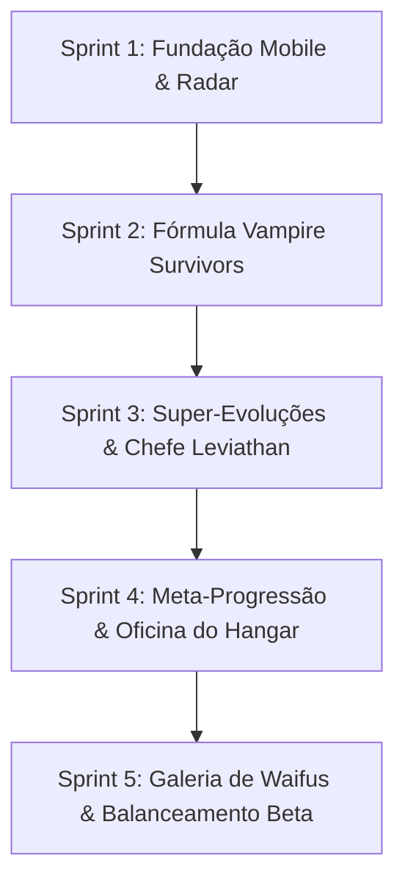

# 🚀 Astra Valkyries: Void Protocol
## Agile Roadmap & Sprint Execution Plan

**Projeto:** *Astra Valkyries: Void Protocol*  
**Versão Atual:** Alpha 0.5.0  
**Stack:** Flutter + Flame (Engine 2D Vetorial) & Go Backend (Central Cloud API)  
**Data:** 06/11/2026  

---

### Visão Geral do Ciclo de Produção

---

## 🏁 SPRINT 1: Fundação Mobile-First, Setor 4.8k & Pilotos
- **Status:** ✅ **CONCLUÍDA** (Commits `52deeef`, `b262d82`)
- **Objetivo:** Estabelecer a física inercial de voo, o mapa procedural expansivo e a adaptação ergonômica de toque para smartphones.

### Entregáveis:
- [x] Setor procedural aberto de 4800x4800 com bordas de contenção de plasma.
- [x] Câmera dinâmica com rastreamento suave da nave da jogadora.
- [x] Mini-radar tático vetorial com cálculo de alcance e ângulo de varredura.
- [x] POIs Procedurais: Estação de Pesquisa, Destroços de Carga e Nebulosas Cósmicas.
- [x] HUD Mobile Ergonomic Cluster: Thumb-stick virtual, botão de Dash circular com cooldown, Especial Overdrive e Disparo Manual.
- [x] O Trio Inicial de Valquírias (Lyra, Selene e Vesper) com specs, design de nave e armas iniciais distintas.
- [x] Mini-avatar reativo na HUD com 3 estados (Normal, Crítico e Overdrive).
- [x] Resolução do bug de renderização de overlays no Flutter (`StackParentData`).

---

## 👾 SPRINT 2: Fórmula Vampire Survivors, Frotas & Baús
- **Status:** ✅ **CONCLUÍDA** (Commits `73f0eae`, `ba36fb6`)
- **Objetivo:** Eliminar a monotonia de combate apenas contra meteoros, inserindo IA hostil ativa, minibosses cronometrados e recompensas em baús.

### Entregáveis:
- [x] **Scout Drone:** Nave de enxame (1 a 2 tiros) com perseguição direta e fluxo constante de Stardust XP.
- [x] **Phantom Raider:** Caça veloz com máquina de estados (`stalking` $\to$ `telegraphing` com laser vermelho $\to$ `charging` a 390 px/s com Dash evasivo).
- [x] **Corvette Sniper:** Artilharia de média distância que atira orbes lentos de plasma.
- [x] **Variantes de Asteroides:** Prisma Cristalino (não divide, explode em chuva de 8 orbes de XP) e Asteroide de Magma (poça térmica persistente de dano em área).
- [x] **Void Commander (Elite Miniboss):** Flagship imponente com barra de vida flutuante, tiros em espiral e drop garantido de baú.
- [x] **Baú Cósmico & Jackpot Overlay:** Recompensa de 1x, 3x ou 5x cartas estilo caça-níquel/Vampire Survivors, aplicando upgrades automáticos de arsenal e atributos.
- [x] **Red Gem Siphon (Otimização Mobile):** Teto rígido de 60 orbes de XP em tela, concentrando excedente no orbe mais distante como Hiper-Stardust Vermelho para manter 60 FPS cravados.
- [x] **53 Testes Automatizados** cobrindo todas as mecânicas.

---

## ⚡ SPRINT 3: Super-Evoluções de Armas & Chefe Final de Setor
- **Status:** ✅ **CONCLUÍDA** (Commit `c5a925d`)
- **Objetivo:** Implementar o auge da catarse do combate (armas evoluídas devastadoras) e o clímax da partida (batalha em fases contra o Dreadnought Leviathan).

### Entregáveis:
1. **As 4 Super-Evoluções de Arsenal (Evoluídas via Baú Cósmico no Nível Máximo):**
   - [x] **Supernova Annihilator** (Evolução do *Pulse Blaster*): Feixe duplo acelerado de plasma ultra-denso com micro-detonações em cadeia ao atravessar inimigos (`piercesLeft = 99`, 150 dmg, 0.16s cooldown).
   - [x] **Hyperion Flak Storm** (Evolução do *Spread Cannon*): Barreira circular 360° contínua de fragmentos de flak em 10 direções, desintegrando projéteis e enxames (75 dmg/fragmento, 0.38s cooldown).
   - [x] **Absolute Zero Tachyon Beam** (Evolução do *Phase Laser*): Raio contínuo perfurante criogênico em altíssima cadência (50 dmg, 0.075s cooldown).
   - [x] **Singularity Rift Torpedo** (Evolução do *Antimatter Torpedo*): Torpedo teleguiado de 420 dmg que, ao detonar, invoca um vórtex negro (`SingularityRiftComponent`) com atração gravitacional e colapso estelar.
2. **Chefe Final de Setor: Dreadnought Leviathan:**
   - [x] Spawna com 3.500 HP, raio 72px e telemetria de barra de vida de setor no topo da HUD.
   - [x] **Fase 1 (Escolta & Baterias):** Casco blindado com disparo alternado de torretas duplas de plasma.
   - [x] **Fase 2 (Núcleo Exposto & Danmaku):** Espirais rotativas de 12 projéteis densos em 360°.
   - [x] **Fase 3 (Colapso Hiperbólico):** Disparo telegrafado de feixe de Railgun pesado e invocação de drones de escolta.
3. **Condição de Vitória da Sortie & Jackpots:**
   - [x] Ao destruir o Leviathan, dropa Baú Cósmico Lendário de 5 cartas de Jackpot + 5 gemas gigantes de Stardust, acionando a vitória do setor.
   - [x] 62 testes unitários e de integração passando 100%.

---

## 🛠️ SPRINT 4: Meta-Progressão, Oficina do Hangar & Economia
- **Status:** ✅ **CONCLUÍDA**
- **Objetivo:** Fechar o loop roguelite duradouro, permitindo que cada derrota ou vitória fortaleça a jogadora para as próximas missões.

### Entregáveis:
1. **Oficina das Valquírias (Hangar Workshop & Meta-Progression):**
   - [x] Árvore de Meta-Upgrades permanentes comprados com Sucata Cósmica (*Credits*):
     - *Hull Reinforcement* (Vida inicial +1 a +3);
     - *Ion Magnet Overdrive* (Raio de coleta +20% a +100%);
     - *Hyper-Thrusters* (Velocidade +8% a +40% e redução do Cooldown de Dash);
     - *Quantum Targeting* (Taxa de Crítico +4% a +20% e Dano Geral +6% a +30%);
     - *Lucky Star Protocol* (Chance de Baús 3x e 5x +10% a +40%).
   - [x] Botão de Reembolso Total a 100% (*Refund All*) sem penalidade.
2. **Economia de Sucata Cósmica (Scrap Flow):**
   - [x] Asteroides, frotas inimigas (Scout, Raider, Sniper, Elite) e POIs dropam créditos em tempo real.
   - [x] Bônus de sobrevivência de missão (+350c) e abate do Leviathan (+500c).
   - [x] Telemetria de sucata adicionada à HUD in-game e à tela de Game Over.
3. **Revisão Mobile & Menu Unificado:**
   - [x] Hangar unificado em `ValkyrieSelectionOverlay` com seletor de abas (`SORTIE` vs `OFICINA`).
   - [x] Compatibilidade ergonômica com toque e atalhos de teclado (Tab, Q/E, A/D, Setas, Enter).
4. **Testes Automatizados:**
   - [x] 70 testes automatizados cobrindo progressão, economia e componentes de UI.

---

## 💖 SPRINT 5: Galeria de Waifus, Afinidade & Micro-Balanceamento Beta
- **Status:** 📅 **PLANEJADA**
- **Objetivo:** O motor de engajamento do público de anime, polimento de som/vozes e calibração fina de parâmetros para o lançamento comercial.

### Entregáveis:
1. **Sistema de Afinidade (Bond System):**
   - [ ] Fragmentos de Memória coletados durante as runs aumentam a afinidade com a piloto em uso.
   - [ ] Desbloqueio progressivo de diálogos secretos no Hangar.
2. **Galeria de Memórias Secretas (CGs em Alta Resolução):**
   - [ ] Tela de Galeria no menu principal exibindo ilustrações widescreen (1920x1080) desbloqueadas.
   - [ ] Visualizador de arte com zoom e modo sem interface.
3. **Micro-Balanceamento da Beta:**
   - [ ] Ajuste fino do DPS de cada arma para garantir paridade estratégica.
   - [ ] Calibração da curva de dificuldade dos 10 minutos para curva de tensão perfeita.
